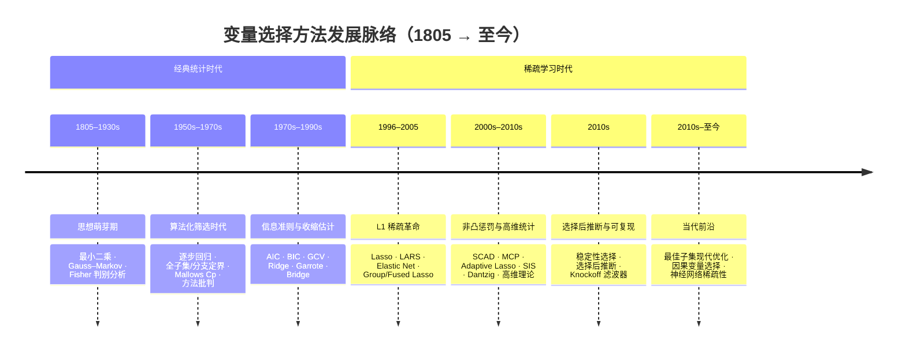

# variable-selection-research

变量选择方法发展脉络综述

本仓库系统梳理变量选择（variable selection）方法自 1805 年以来的发展脉络：按七个历史阶段组织，覆盖各方法的起源文献、诞生背景与动因、核心理论支撑及所解决的关键问题。全部起源文献均经逐条核验（题录信息以 Crossref 等权威记录为准），其中可公开获取的 37 篇 PDF 存于 [`papers/`](papers/) 目录，文件名与题录一一对应；其余 26 篇为付费墙文献、专著或被反爬拦截的开放获取文献，仅收录题录与获取链接（见 [§5](#5-仓库结构说明)）。此外，仓库以"三层架构"组织各方法的可复现学习资料（`lib/` 共享库 + `methods/` 方法模块 + `benchmarks/` 跨方法横评），入口见 [§0](#0-方法学习模块导航)。

## 目录

- [0. 方法学习模块导航](#0-方法学习模块导航)
- [1. 发展脉络总览](#1-发展脉络总览)
  - [1.1 时间线](#11-时间线)
  - [1.2 主线叙事：两次范式跃迁](#12-主线叙事两次范式跃迁)
- [2. 七个发展阶段详解](#2-七个发展阶段详解)
  - [2.1 思想萌芽期（1805–1930s）](#21-思想萌芽期18051930s)
  - [2.2 算法化筛选时代（1950s–1970s）](#22-算法化筛选时代1950s1970s)
  - [2.3 信息准则与收缩估计（1970s–1990s）](#23-信息准则与收缩估计1970s1990s)
  - [2.4 L1 稀疏革命时代（1996–2005）](#24-l1-稀疏革命时代19962005)
  - [2.5 非凸惩罚与高维统计（2000s–2010s）](#25-非凸惩罚与高维统计2000s2010s)
  - [2.6 选择后推断与可复现（2010s）](#26-选择后推断与可复现2010s)
  - [2.7 当代前沿（2010s–至今）](#27-当代前沿2010s至今)
- [3. 方法体系横向对比](#3-方法体系横向对比)
- [4. 参考文献题录](#4-参考文献题录)
- [5. 仓库结构说明](#5-仓库结构说明)

## 0. 方法学习模块导航

除本综述外，仓库按"三层架构"组织各方法的可复现学习资料（一个方法一个文件夹，编号对应 §2 时间线顺序）：

- **`lib/`** — 共享工具库：数据加载（`data.py`）、评估指标（`metrics.py`）、绘图风格（`plotting.py`），全仓库唯一入口，避免各方法重复造轮子；
- **`methods/`** — 方法学习模块：每个文件夹含逐段讲解的从零实现、七段式主文档、可运行实验及图表结果；
- **`benchmarks/`** — （规划中）跨方法横评，待方法模块攒够 3 个以上后建立。

| 编号 | 方法 | 状态 | 入口 |
| :--- | :--- | :--- | :--- |
| 01 | 最小二乘（OLS） | 已完成 | [methods/01-least-squares/](methods/01-least-squares/) |
| 02 | Fisher 判别分析（FDA） | 已完成 | [methods/02-fisher-discriminant/](methods/02-fisher-discriminant/) |

新增方法请从 [methods/_template/](methods/_template/) 复制模板；写作风格、代码与实验规范见模板文件及各方法文档。

## 1. 发展脉络总览

### 1.1 时间线



### 1.2 主线叙事：两次范式跃迁

两百余年的发展可概括为一条主线与两次跃迁：

- **一条主线**：从"先拟合再筛选"（最小二乘 → 逐步回归/子集选择 → 信息准则）演进到"筛选即估计"（惩罚正则化），再到"选择之后仍需可推断、可复现"（稳定性选择、选择后推断、Knockoff）。
- **第一次跃迁（1996，Lasso）**：以 L1 惩罚把变量选择嵌入连续凸优化，实现收缩与精确置零的统一，开启稀疏学习范式。
- **第二次跃迁（2000s–2010s）**：非凸惩罚（SCAD/MCP）修正 L1 的有偏性，高维统计理论（相容性条件、预测误差界）与压缩感知思想（Dantzig Selector）解决 p≫n 的可行性，SIS 进一步应对超高维。
- **当前走向**：最佳子集的现代优化复兴、因果导向的选择，以及深度学习中的稀疏性研究。

## 2. 七个发展阶段详解

### 2.1 思想萌芽期（1805–1930s）

天文学与实验科学的数据拟合需求催生了最小二乘；多指标分类问题则推动了特征组合方法的出现。这一阶段确立了"以尽量简洁的模型解释数据"的方法论初旨，但"变量选择"尚未成为独立问题。

| 方法 | 起源文献 | 核心理论支撑 | 所解决的关键问题 |
| :--- | :--- | :--- | :--- |
| 最小二乘 | Legendre (1805)；Gauss (1809) [仅题录] | 最小二乘估计、Gauss–Markov 定理（现代表述见 [55][56]） | 以尽量少的参数拟合观测数据 |
| Fisher 判别分析 | Fisher (1936), *Annals of Eugenics* 7(2): 179–188 [PDF](papers/Fisher_1936_MultipleMeasurements.pdf) | 线性组合最大化类间/类内散度比 | 多指标分类中的特征组合与降维 |

### 2.2 算法化筛选时代（1950s–1970s）

时代共因：计算资源有限、候选变量激增（"Hughes 效应"，Hughes 1968 [仅题录]）、多重共线性普遍。核心动机是让筛选自动化。

| 方法 | 起源文献 | 核心理论支撑 | 所解决的关键问题 |
| :--- | :--- | :--- | :--- |
| 逐步选择法 | Efroymson (1960)；Draper & Smith (1966)；Beale, Kendall & Mann (1967), *Biometrika* 54(3–4): 357–366 [仅题录] | 贪心算法 + F/t 检验纳入剔除准则 | 高维候选变量下的半自动筛选 |
| 全子集选择与分支定界 | Furnival & Wilson (1974), *Technometrics* 16(4): 499–511 [仅题录]；Hocking (1976), *Biometrics* 32(1): 1–49 [仅题录] | 组合优化的全局搜索 | 克服逐步法的局部最优（受组合爆炸限制） |
| Mallows Cp | Mallows (1973), *Technometrics* 15(4): 661–675 [仅题录] | 均方预测误差的无偏估计 | 模型拟合优度与复杂度的权衡准则 |
| 方法论批判 | Mantel (1970), *Technometrics* 12(3): 621–625 [仅题录]；Miller (1984), *JRSS A* 147(3): 389–425 [仅题录] | 模拟研究与系统综述 | 揭示逐步法的过拟合与不稳定性，确立变量选择的问题意识 |

### 2.3 信息准则与收缩估计（1970s–1990s）

对逐步法的不满催生了两条修正路线：一条以信息论/重抽样给出模型复杂度准则，一条以收缩估计换取方差稳定性。

| 方法 | 起源文献 | 核心理论支撑 | 所解决的关键问题 |
| :--- | :--- | :--- | :--- |
| 交叉验证 / GCV | Stone (1974), *JRSS B* 36(2): 111–133 [仅题录]；Golub, Heath & Wahba (1979), *Technometrics* 21(2): 215–223 [PDF](papers/Golub_Heath_Wahba_1979_GeneralizedCrossValidation.pdf) | 重抽样与预测误差直接估计 | 以样本外表现作为模型选择依据 |
| AIC | Akaike (1974), *IEEE Trans. Automatic Control* 19(6): 716–723 [PDF](papers/Akaike_1974_NewLookModelIdentification.pdf) | Kullback–Leibler 散度 + 渐近无偏性 | 以预测为导向的复杂度惩罚 |
| BIC | Schwarz (1978), *Annals of Statistics* 6(2): 461–464 [PDF](papers/Schwarz_1978_EstimatingDimension.pdf) | 贝叶斯边际似然与拉普拉斯近似 | 大样本下一致识别真实模型 |
| Ridge 回归 | Hoerl & Kennard (1970), *Technometrics* 12(1): 55–67 [PDF](papers/Hoerl_Kennard_1970_RidgeRegression.pdf)；理论先声：James & Stein (1961) [仅题录] | L2 惩罚与偏差–方差权衡 | 多重共线性下的估计稳定性（不产生稀疏解） |
| Nonnegative Garrote | Breiman (1995), *Technometrics* 37(4): 373–384 [PDF](papers/Breiman_1995_NonnegativeGarrote.pdf) | 乘性收缩 + 阈值化 | 在收缩估计与子集选择之间架桥 |
| Bridge 回归 | Frank & Friedman (1993), *Technometrics* 35(2): 109–135 [PDF](papers/Frank_Friedman_1993_ChemometricsRegressionTools.pdf) | Lq（0<q≤1）桥惩罚 | 系统探索 L1/L2 之外的惩罚路径 |

### 2.4 L1 稀疏革命时代（1996–2005）

1996 年之前，变量选择存在两条并行却各有缺陷的路径：组合式子集搜索（逐步回归、全子集）受计算复杂度与选择不稳定性的双重制约；连续收缩方法（Ridge、Garrote、Bridge）虽估计稳定，却不产生稀疏解。Tibshirani 提出的 Lasso 首次在凸优化框架内同时实现系数收缩与精确置零，变量选择由此进入"正则化即选择"的稀疏学习范式。

| 方法 | 起源文献 | 核心理论支撑 | 所解决的关键问题 |
| :--- | :--- | :--- | :--- |
| Lasso | Tibshirani (1996), *JRSS B* 58(1): 267–288 [PDF](papers/Tibshirani_1996_Lasso.pdf) | L1 惩罚、凸优化、软阈值算子 | 连续优化下同时实现系数收缩与精确置零 |
| LARS 与路径算法 | Efron, Hastie, Johnstone & Tibshirani (2004), *Annals of Statistics* 32(2): 407–499 [PDF](papers/Efron_Hastie_Johnstone_Tibshirani_2004_LeastAngleRegression.pdf)；Fu (1998) [仅题录]；Osborne, Presnell & Turlach (2000), *JCGS* 9(2): 319–337 [PDF](papers/Osborne_Presnell_Turlach_2000_LassoDual.pdf)；Friedman et al. (2007) [PDF](papers/Friedman_Hastie_Hofling_Tibshirani_2007_PathwiseCoordinateOptimization.pdf) | 分段线性解路径、坐标下降 | 整条正则路径的高效计算 |
| Elastic Net | Zou & Hastie (2005), *JRSS B* 67(2): 301–320 [PDF](papers/Zou_Hastie_2005_ElasticNet.pdf) | L1+L2 混合惩罚、分组效应 | p>n 且强相关时 Lasso 至多选 n 个、选择不稳定 |
| Fused Lasso | Tibshirani, Saunders, Rosset, Zhu & Knight (2005), *JRSS B* 67(1): 91–108 [PDF](papers/Tibshirani_Saunders_Rosset_Zhu_Knight_2005_FusedLasso.pdf) | L1 + 一阶差分惩罚 | 有序/时空结构信号的稀疏与平滑 |
| Group Lasso | Yuan & Lin (2006), *JRSS B* 68(1): 49–67 [仅题录] | 组级 L1 + 组内 L2 | 预定义分组（如基因通路）的成组选择 |
| Relaxed Lasso | Meinshausen (2007), *CSDA* 52(1): 374–393 [PDF](papers/Meinshausen_2007_RelaxedLasso.pdf) | 两步去偏估计 | 缓解 L1 对重要系数的过度收缩 |

这一时代的方法共享统一的惩罚似然形式，差别仅在惩罚项 $p_\lambda(\cdot)$ 与结构项的设计：

$$
\hat{\beta} = \arg\min_{\beta \in \mathbb{R}^{p}} \frac{1}{2n}\|y - X\beta\|_2^2 + \lambda \sum_{j=1}^{p} p_\lambda(|\beta_j|)
$$

> **范式解读**：Lasso 的贡献不在具体算法，而在形式化——把"选择变量"这一离散决策转化为连续凸优化问题。此后二十余年的工作（结构化稀疏、非凸惩罚、高维理论、选择后推断）几乎都是在这一框架上替换惩罚项或叠加结构约束。

### 2.5 非凸惩罚与高维统计（2000s–2010s）

L1 对重要系数的有偏收缩与高维场景的理论空白，由非凸惩罚、信号处理领域的压缩感知思想以及高维统计理论共同填补。

| 方法 | 起源文献 | 核心理论支撑 | 所解决的关键问题 |
| :--- | :--- | :--- | :--- |
| SCAD | Fan & Li (2001), *JASA* 96(456): 1348–1360 [PDF](papers/Fan_Li_2001_NonconcavePenalizedLikelihood.pdf) | 非凸凹惩罚 | 克服 L1 过度收缩，获得 oracle 性质 |
| Adaptive Lasso | Zou (2006), *JASA* 101(476): 1418–1429 [PDF](papers/Zou_2006_AdaptiveLasso.pdf) | 加权 L1 两阶段估计 | 以自适应权重实现 oracle 性质 |
| MCP | Zhang (2010), *Annals of Statistics* 38(2): 894–942 [PDF](papers/Zhang_2010_MinimaxConcavePenalty.pdf) | 极小极大凹惩罚 | 近无偏变量选择 |
| Dantzig Selector | Candès & Tao (2007), *Annals of Statistics* 35(6): 2313–2351 [PDF](papers/Candes_Tao_2007_DantzigSelector.pdf)；源于压缩感知：Donoho (2006) [PDF](papers/Donoho_2006_CompressedSensing.pdf)；Candès, Romberg & Tao (2006) [PDF](papers/Candes_Romberg_Tao_2006_RobustUncertaintyPrinciples.pdf) | ℓ1 约束最小化与 RIP/零空间条件 | p≫n 下的稀疏信号恢复 |
| SIS（确定性独立筛选） | Fan & Lv (2008), *JRSS B* 70(5): 849–911 [PDF](papers/Fan_Lv_2008_SureIndependenceScreening.pdf) | 边际相关筛选 + 迭代 ISIS | 超高维（维度随 n 指数增长）的第一层降维 |
| 高维 Lasso 理论 | Greenshtein & Ritov (2004), *Bernoulli* 10(6): 971–988 [仅题录]；Wainwright (2009), *IEEE TIT* 55(5): 2183–2202 [PDF](papers/Wainwright_2009_SharpThresholds.pdf)；Bickel, Ritov & Tsybakov (2009), *Annals of Statistics* 37(4): 1705–1732 [PDF](papers/Bickel_Ritov_Tsybakov_2009_LassoDantzig.pdf)；van de Geer & Bühlmann (2009), *EJS* 3: 1360–1392 [PDF](papers/vandeGeer_Buhlmann_2009_OracleResultsLasso.pdf) | 限制特征值/相容性条件、预测误差界 | 高维场景下 Lasso 的理论保证 |

### 2.6 选择后推断与可复现（2010s）

稀疏方法解决了"选得准"，但"选完之后还能不能做有效的统计推断"成为新焦点；同时数据微小扰动即导致选择剧变的问题也催生了稳定性研究。

| 方法 | 起源文献 | 核心理论支撑 | 所解决的关键问题 |
| :--- | :--- | :--- | :--- |
| 稳定性选择 | Meinshausen & Bühlmann (2010), *JRSS B* 72(4): 417–473 [PDF](papers/Meinshausen_Buhlmann_2010_StabilitySelection.pdf) | 子抽样 + 入选频率阈值 | 选择结果对数据扰动的不稳定性 |
| 选择后推断 | Berk et al. (2013), *Annals of Statistics* 41(2): 802–837 [PDF](papers/Berk_etal_2013_ValidPostSelectionInference.pdf)；Lockhart et al. (2014), *Annals of Statistics* 42(2): 413–468 [PDF](papers/Lockhart_etal_2014_SignificanceTestLasso.pdf)；Lee et al. (2016), *Annals of Statistics* 44(3): 907–927 [PDF](papers/Lee_Sun_Sun_Taylor_2016_ExactPostSelectionInference.pdf)；Taylor & Tibshirani (2018), *Canadian Journal of Statistics* 46(1): 41–61 [PDF](papers/Taylor_Tibshirani_2018_PostSelectionInference.pdf) | 条件于选择事件的有效推断 | "先选择后检验"的选择性偏差（p-hacking） |
| Knockoff 滤波器 | Barber & Candès (2015), *Annals of Statistics* 43(5): 2055–2085 [PDF](papers/Barber_Candes_2015_Knockoffs.pdf) | 构造"敲除"变量对 | 变量选择与 FDR 严格控制同时实现 |

### 2.7 当代前沿（2010s–至今）

| 方法方向 | 起源文献 | 核心理论支撑 | 所解决的关键问题 |
| :--- | :--- | :--- | :--- |
| 最佳子集选择的现代复兴 | Bertsimas, King & Mazumder (2016), *Annals of Statistics* 44(2): 813–852 [PDF](papers/Bertsimas_King_Mazumder_2016_BestSubsetSelection.pdf)；Hazimeh & Mazumder (2020), *Operations Research* 68(5): 1517–1537 [PDF](papers/Hazimeh_Mazumder_2020_FastBestSubsetSelection.pdf) | 混合整数优化与局部组合算法 | L1 凸松弛与真实 k-稀疏解之间的差距 |
| 多研究/多任务整合 | Obozinski, Taskar & Jordan (2010), *Statistics and Computing* 20(2): 231–252 [PDF](papers/Obozinski_Taskar_Jordan_2010_JointCovariateSelection.pdf) | 共享稀疏结构先验 | 跨数据集/跨任务的选择一致性 |
| 因果变量选择 | Peters, Bühlmann & Meinshausen (2016), *JRSS B* 78(5): 947–1012 [PDF](papers/Peters_Buhlmann_Meinshausen_2016_InvariantCausalPrediction.pdf) | 不变性原理 | 分布变化下选择因果相关变量（相关 ≠ 因果） |
| 深度学习时代的稀疏性 | Han, Pool, Tran & Dally (2015), *NIPS 28*: 1135–1143 [PDF](papers/Han_Pool_Tran_Dally_2015_EfficientNeuralNetworks.pdf)；Frankle & Carbin (2019), *ICLR* [PDF](papers/Frankle_Carbin_2019_LotteryTicketHypothesis.pdf) | 网络剪枝与彩票假说 | 高维非线性下的可解释性与模型压缩 |

## 3. 方法体系横向对比

| 时代 | 方法族 | 代表文献 | 惩罚/机制 | 稀疏性 | 高维支持 | 偏差处理 | 推断支持 |
| :--- | :--- | :--- | :--- | :--- | :--- | :--- | :--- |
| 二 | 逐步回归/子集选择 | Efroymson (1960)；Furnival & Wilson (1974) | 组合搜索 | 有（离散） | 弱 | — | 无 |
| 三 | AIC/BIC/GCV | Akaike (1974)；Schwarz (1978)；Golub et al. (1979) | 复杂度惩罚 | 有（模型选择） | 弱 | — | 无 |
| 三 | Ridge | Hoerl & Kennard (1970) | L2 | 无 | 弱 | 有偏 | 无 |
| 三 | Garrote/Bridge | Breiman (1995)；Frank & Friedman (1993) | 收缩+阈值 / Lq | 有 | 弱 | 部分 | 无 |
| 四 | Lasso | Tibshirani (1996) | L1 | 有 | 中 | 有偏 | 无 |
| 四 | Elastic Net/Group/Fused | Zou & Hastie (2005)；Yuan & Lin (2006)；Tibshirani et al. (2005) | L1+L2 / 组结构 | 有（结构化） | 强 | 有偏 | 无 |
| 五 | SCAD/MCP/Adaptive | Fan & Li (2001)；Zhang (2010)；Zou (2006) | 非凸 / 加权 L1 | 有 | 强 | 近无偏（oracle） | 无 |
| 五 | SIS | Fan & Lv (2008) | 边际筛选 | 有 | 极强 | — | 无 |
| 六 | 稳定性选择/Knockoff/选择后推断 | Meinshausen & Bühlmann (2010)；Barber & Candès (2015)；Lee et al. (2016) | 重抽样 / 推断校正 | — | 强 | — | 有（FDR / 有效区间） |
| 七 | 最佳子集/因果/深度学习 | Bertsimas et al. (2016)；Peters et al. (2016)；Han et al. (2015) | MIO / 不变性 / 剪枝 | 有 | 强 | — | 部分 |

## 4. 参考文献题录

按章节顺序编号；`[PDF]` 表示已下载至 `papers/`，`[仅题录]` 表示仅收录题录（原因见 §5）。末尾附 2026-10-23/24 增补的支撑文献（编号 53–63）。

**2.1 思想萌芽期**

1. Legendre, A. M. (1805). *Nouvelles méthodes pour la détermination des orbites des comètes*. Paris: Courcier.（书中所含最小二乘法附录发表于 1805 年 3 月）[仅题录]
2. Gauss, C. F. (1809). *Theoria motus corporum coelestium in sectionibus conicis solem ambientium*. Hamburg: Sumtibus Frid. Perthes et I. H. Besser. [仅题录]
3. Fisher, R. A. (1936). The use of multiple measurements in taxonomic problems. *Annals of Eugenics*, 7(2): 179–188. DOI: [10.1111/j.1469-1809.1936.tb02137.x](https://doi.org/10.1111/j.1469-1809.1936.tb02137.x) [PDF](papers/Fisher_1936_MultipleMeasurements.pdf)

**2.2 算法化筛选时代**

4. Hughes, G. F. (1968). On the mean accuracy of statistical pattern recognizers. *IEEE Transactions on Information Theory*, 14(1): 55–63. DOI: [10.1109/TIT.1968.1054102](https://doi.org/10.1109/TIT.1968.1054102) [仅题录]
5. Efroymson, M. A. (1960). Multiple regression analysis. In A. Ralston & H. S. Wilf (Eds.), *Mathematical Methods for Digital Computers* (Vol. 1, pp. 191–203). New York: Wiley. [仅题录]
6. Draper, N. R., & Smith, H. (1966). *Applied Regression Analysis* (1st ed.). New York: Wiley. [仅题录]
7. Beale, E. M. L., Kendall, M. G., & Mann, D. W. (1967). The discarding of variables in multivariate analysis. *Biometrika*, 54(3–4): 357–366. DOI: [10.1093/biomet/54.3-4.357](https://doi.org/10.1093/biomet/54.3-4.357) [仅题录]
8. Furnival, G. M., & Wilson, R. W., Jr. (1974). Regressions by leaps and bounds. *Technometrics*, 16(4): 499–511. DOI: [10.1080/00401706.1974.10489231](https://doi.org/10.1080/00401706.1974.10489231) [仅题录]
9. Hocking, R. R. (1976). The analysis and selection of variables in linear regression. *Biometrics*, 32(1): 1–49. DOI: [10.2307/2529336](https://doi.org/10.2307/2529336) [仅题录]
10. Mallows, C. L. (1973). Some comments on $C_p$. *Technometrics*, 15(4): 661–675. DOI: [10.1080/00401706.1973.10489103](https://doi.org/10.1080/00401706.1973.10489103)（JSTOR: 10.2307/1267380）[仅题录]
11. Mantel, N. (1970). Why stepdown procedures in variable selection. *Technometrics*, 12(3): 621–625. DOI: [10.1080/00401706.1970.10488701](https://doi.org/10.1080/00401706.1970.10488701) [仅题录]
12. Miller, A. J. (1984). Selection of subsets of regression variables (with discussion). *Journal of the Royal Statistical Society, Series A*, 147(3): 389–425. DOI: [10.2307/2981576](https://doi.org/10.2307/2981576) [仅题录]；专著版：Miller, A. J. (1990). *Subset Selection in Regression*. London: Chapman & Hall. [仅题录]

**2.3 信息准则与收缩估计**

13. Stone, M. (1974). Cross-validatory choice and assessment of statistical predictions. *Journal of the Royal Statistical Society, Series B*, 36(2): 111–133（含讨论至 147）. DOI: [10.1111/j.2517-6161.1974.tb00994.x](https://doi.org/10.1111/j.2517-6161.1974.tb00994.x)（JSTOR: 2984809）[仅题录]
14. Golub, G. H., Heath, M., & Wahba, G. (1979). Generalized cross-validation as a method for choosing a good ridge parameter. *Technometrics*, 21(2): 215–223. DOI: [10.1080/00401706.1979.10489751](https://doi.org/10.1080/00401706.1979.10489751) [PDF](papers/Golub_Heath_Wahba_1979_GeneralizedCrossValidation.pdf)
15. Akaike, H. (1974). A new look at the statistical model identification. *IEEE Transactions on Automatic Control*, 19(6): 716–723. DOI: [10.1109/TAC.1974.1100705](https://doi.org/10.1109/TAC.1974.1100705) [PDF](papers/Akaike_1974_NewLookModelIdentification.pdf)
16. Schwarz, G. (1978). Estimating the dimension of a model. *The Annals of Statistics*, 6(2): 461–464. DOI: [10.1214/aos/1176344136](https://doi.org/10.1214/aos/1176344136) [PDF](papers/Schwarz_1978_EstimatingDimension.pdf)
17. Hoerl, A. E., & Kennard, R. W. (1970). Ridge regression: biased estimation for nonorthogonal problems. *Technometrics*, 12(1): 55–67. DOI: [10.1080/00401706.1970.10488634](https://doi.org/10.1080/00401706.1970.10488634)（JSTOR: 1267351）[PDF](papers/Hoerl_Kennard_1970_RidgeRegression.pdf)
18. James, W., & Stein, C. (1961). Estimation with quadratic loss. *Proceedings of the Fourth Berkeley Symposium on Mathematical Statistics and Probability*, Vol. 1: 361–379. Berkeley: University of California Press. [仅题录]
19. Frank, I. E., & Friedman, J. H. (1993). A statistical view of some chemometrics regression tools. *Technometrics*, 35(2): 109–135（含讨论至 148）. DOI: [10.1080/00401706.1993.10485033](https://doi.org/10.1080/00401706.1993.10485033) [PDF](papers/Frank_Friedman_1993_ChemometricsRegressionTools.pdf)
20. Breiman, L. (1995). Better subset regression using the nonnegative garrote. *Technometrics*, 37(4): 373–384. DOI: [10.1080/00401706.1995.10484371](https://doi.org/10.1080/00401706.1995.10484371) [PDF](papers/Breiman_1995_NonnegativeGarrote.pdf)

**2.4 L1 稀疏革命时代**

21. Tibshirani, R. (1996). Regression shrinkage and selection via the lasso. *Journal of the Royal Statistical Society, Series B*, 58(1): 267–288. DOI: [10.1111/j.2517-6161.1996.tb02080.x](https://doi.org/10.1111/j.2517-6161.1996.tb02080.x) [PDF](papers/Tibshirani_1996_Lasso.pdf)
22. Fu, W. J. (1998). Penalized regressions: the bridge versus the lasso. *Journal of Computational and Graphical Statistics*, 7(3): 397–416. DOI: [10.1080/10618600.1998.10474784](https://doi.org/10.1080/10618600.1998.10474784) [仅题录]
23. Osborne, M. R., Presnell, B., & Turlach, B. A. (2000). On the lasso and its dual. *Journal of Computational and Graphical Statistics*, 9(2): 319–337. DOI: [10.1080/10618600.2000.10474883](https://doi.org/10.1080/10618600.2000.10474883) [PDF](papers/Osborne_Presnell_Turlach_2000_LassoDual.pdf)
24. Efron, B., Hastie, T., Johnstone, I., & Tibshirani, R. (2004). Least angle regression. *The Annals of Statistics*, 32(2): 407–499. DOI: [10.1214/009053604000000067](https://doi.org/10.1214/009053604000000067) [PDF](papers/Efron_Hastie_Johnstone_Tibshirani_2004_LeastAngleRegression.pdf)
25. Friedman, J., Hastie, T., Höfling, H., & Tibshirani, R. (2007). Pathwise coordinate optimization. *The Annals of Applied Statistics*, 1(2): 302–332. DOI: [10.1214/07-AOAS131](https://doi.org/10.1214/07-AOAS131)（预印本 arXiv:0708.1485）[PDF](papers/Friedman_Hastie_Hofling_Tibshirani_2007_PathwiseCoordinateOptimization.pdf)
26. Zou, H., & Hastie, T. (2005). Regularization and variable selection via the elastic net. *Journal of the Royal Statistical Society, Series B*, 67(2): 301–320. DOI: [10.1111/j.1467-9868.2005.00503.x](https://doi.org/10.1111/j.1467-9868.2005.00503.x) [PDF](papers/Zou_Hastie_2005_ElasticNet.pdf)
27. Tibshirani, R., Saunders, M., Rosset, S., Zhu, J., & Knight, K. (2005). Sparsity and smoothness via the fused lasso. *Journal of the Royal Statistical Society, Series B*, 67(1): 91–108. DOI: [10.1111/j.1467-9868.2005.00490.x](https://doi.org/10.1111/j.1467-9868.2005.00490.x) [PDF](papers/Tibshirani_Saunders_Rosset_Zhu_Knight_2005_FusedLasso.pdf)
28. Yuan, M., & Lin, Y. (2006). Model selection and estimation in regression with grouped variables. *Journal of the Royal Statistical Society, Series B*, 68(1): 49–67. DOI: [10.1111/j.1467-9868.2005.00532.x](https://doi.org/10.1111/j.1467-9868.2005.00532.x) [仅题录]
29. Meinshausen, N. (2007). Relaxed lasso. *Computational Statistics & Data Analysis*, 52(1): 374–393. DOI: [10.1016/j.csda.2006.12.019](https://doi.org/10.1016/j.csda.2006.12.019) [PDF](papers/Meinshausen_2007_RelaxedLasso.pdf)

**2.5 非凸惩罚与高维统计**

30. Fan, J., & Li, R. (2001). Variable selection via nonconcave penalized likelihood and its oracle properties. *Journal of the American Statistical Association*, 96(456): 1348–1360. DOI: [10.1198/016214501753382273](https://doi.org/10.1198/016214501753382273) [PDF](papers/Fan_Li_2001_NonconcavePenalizedLikelihood.pdf)
31. Zou, H. (2006). The adaptive lasso and its oracle properties. *Journal of the American Statistical Association*, 101(476): 1418–1429. DOI: [10.1198/016214506000000735](https://doi.org/10.1198/016214506000000735) [PDF](papers/Zou_2006_AdaptiveLasso.pdf)
32. Zhang, C.-H. (2010). Nearly unbiased variable selection under minimax concave penalty. *The Annals of Statistics*, 38(2): 894–942. DOI: [10.1214/09-AOS729](https://doi.org/10.1214/09-AOS729) [PDF](papers/Zhang_2010_MinimaxConcavePenalty.pdf)
33. Donoho, D. L. (2006). Compressed sensing. *IEEE Transactions on Information Theory*, 52(4): 1289–1306. DOI: [10.1109/TIT.2006.871582](https://doi.org/10.1109/TIT.2006.871582) [PDF](papers/Donoho_2006_CompressedSensing.pdf)
34. Candès, E. J., Romberg, J. K., & Tao, T. (2006). Robust uncertainty principles: exact signal reconstruction from highly incomplete frequency information. *IEEE Transactions on Information Theory*, 52(2): 489–509. DOI: [10.1109/TIT.2005.862083](https://doi.org/10.1109/TIT.2005.862083) [PDF](papers/Candes_Romberg_Tao_2006_RobustUncertaintyPrinciples.pdf)
35. Candès, E., & Tao, T. (2007). The Dantzig selector: statistical estimation when p is much larger than n. *The Annals of Statistics*, 35(6): 2313–2351. DOI: [10.1214/009053606000001523](https://doi.org/10.1214/009053606000001523) [PDF](papers/Candes_Tao_2007_DantzigSelector.pdf)
36. Fan, J., & Lv, J. (2008). Sure independence screening for ultrahigh dimensional feature space. *Journal of the Royal Statistical Society, Series B*, 70(5): 849–911. DOI: [10.1111/j.1467-9868.2008.00674.x](https://doi.org/10.1111/j.1467-9868.2008.00674.x) [PDF](papers/Fan_Lv_2008_SureIndependenceScreening.pdf)
37. Greenshtein, E., & Ritov, Y. (2004). Persistence in high-dimensional linear predictor selection and the virtue of overparametrization. *Bernoulli*, 10(6): 971–988. DOI: [10.3150/bj/1106314846](https://doi.org/10.3150/bj/1106314846) [仅题录]
38. Wainwright, M. J. (2009). Sharp thresholds for high-dimensional and noisy sparsity recovery using $\ell_1$-constrained quadratic programming (Lasso). *IEEE Transactions on Information Theory*, 55(5): 2183–2202. DOI: [10.1109/TIT.2009.2016018](https://doi.org/10.1109/TIT.2009.2016018) [PDF](papers/Wainwright_2009_SharpThresholds.pdf)
39. Bickel, P. J., Ritov, Y., & Tsybakov, A. B. (2009). Simultaneous analysis of lasso and Dantzig selector. *The Annals of Statistics*, 37(4): 1705–1732. DOI: [10.1214/08-AOS620](https://doi.org/10.1214/08-AOS620) [PDF](papers/Bickel_Ritov_Tsybakov_2009_LassoDantzig.pdf)
40. van de Geer, S. A., & Bühlmann, P. (2009). On the conditions used to prove oracle results for the lasso. *Electronic Journal of Statistics*, 3: 1360–1392. DOI: [10.1214/09-EJS506](https://doi.org/10.1214/09-EJS506) [PDF](papers/vandeGeer_Buhlmann_2009_OracleResultsLasso.pdf)

**2.6 选择后推断与可复现**

41. Meinshausen, N., & Bühlmann, P. (2010). Stability selection. *Journal of the Royal Statistical Society, Series B*, 72(4): 417–473. DOI: [10.1111/j.1467-9868.2010.00740.x](https://doi.org/10.1111/j.1467-9868.2010.00740.x) [PDF](papers/Meinshausen_Buhlmann_2010_StabilitySelection.pdf)
42. Berk, R., Brown, L., Buja, A., Zhang, K., & Zhao, L. (2013). Valid post-selection inference. *The Annals of Statistics*, 41(2): 802–837. DOI: [10.1214/12-AOS1077](https://doi.org/10.1214/12-AOS1077) [PDF](papers/Berk_etal_2013_ValidPostSelectionInference.pdf)
43. Lockhart, R., Taylor, J., Tibshirani, R. J., & Tibshirani, R. (2014). A significance test for the lasso. *The Annals of Statistics*, 42(2): 413–468. DOI: [10.1214/13-AOS1175](https://doi.org/10.1214/13-AOS1175) [PDF](papers/Lockhart_etal_2014_SignificanceTestLasso.pdf)
44. Lee, J. D., Sun, D. L., Sun, Y., & Taylor, J. E. (2016). Exact post-selection inference, with application to the lasso. *The Annals of Statistics*, 44(3): 907–927. DOI: [10.1214/15-AOS1371](https://doi.org/10.1214/15-AOS1371) [PDF](papers/Lee_Sun_Sun_Taylor_2016_ExactPostSelectionInference.pdf)
45. Taylor, J., & Tibshirani, R. (2018). Post-selection inference for $\ell_1$-penalized likelihood models. *Canadian Journal of Statistics*, 46(1): 41–61. DOI: [10.1002/cjs.11313](https://doi.org/10.1002/cjs.11313) [PDF](papers/Taylor_Tibshirani_2018_PostSelectionInference.pdf)
46. Barber, R. F., & Candès, E. J. (2015). Controlling the false discovery rate via knockoffs. *The Annals of Statistics*, 43(5): 2055–2085. DOI: [10.1214/15-AOS1337](https://doi.org/10.1214/15-AOS1337) [PDF](papers/Barber_Candes_2015_Knockoffs.pdf)

**2.7 当代前沿**

47. Bertsimas, D., King, A., & Mazumder, R. (2016). Best subset selection via a modern optimization lens. *The Annals of Statistics*, 44(2): 813–852. DOI: [10.1214/15-AOS1388](https://doi.org/10.1214/15-AOS1388) [PDF](papers/Bertsimas_King_Mazumder_2016_BestSubsetSelection.pdf)
48. Hazimeh, H., & Mazumder, R. (2020). Fast best subset selection: coordinate descent and local combinatorial optimization algorithms. *Operations Research*, 68(5): 1517–1537. DOI: [10.1287/opre.2019.1919](https://doi.org/10.1287/opre.2019.1919) [PDF](papers/Hazimeh_Mazumder_2020_FastBestSubsetSelection.pdf)
49. Obozinski, G., Taskar, B., & Jordan, M. I. (2010). Joint covariate selection and joint subspace selection for multiple classification problems. *Statistics and Computing*, 20(2): 231–252. DOI: [10.1007/s11222-008-9111-x](https://doi.org/10.1007/s11222-008-9111-x) [PDF](papers/Obozinski_Taskar_Jordan_2010_JointCovariateSelection.pdf)
50. Peters, J., Bühlmann, P., & Meinshausen, N. (2016). Causal inference by using invariant prediction: identification and confidence intervals. *Journal of the Royal Statistical Society, Series B*, 78(5): 947–1012. DOI: [10.1111/rssb.12167](https://doi.org/10.1111/rssb.12167) [PDF](papers/Peters_Buhlmann_Meinshausen_2016_InvariantCausalPrediction.pdf)
51. Han, S., Pool, J., Tran, J., & Dally, W. J. (2015). Learning both weights and connections for efficient neural networks. *Advances in Neural Information Processing Systems 28 (NIPS 2015)*: 1135–1143. [PDF](papers/Han_Pool_Tran_Dally_2015_EfficientNeuralNetworks.pdf)
52. Frankle, J., & Carbin, M. (2019). The lottery ticket hypothesis: finding sparse, trainable neural networks. *International Conference on Learning Representations (ICLR) 2019*. [PDF](papers/Frankle_Carbin_2019_LotteryTicketHypothesis.pdf)

**增补文献（2026-10-23/24，支撑 §2.1 与方法模块 01-least-squares、02-fisher-discriminant）**

53. Stigler, S. M. (1981). Gauss and the invention of least squares. *The Annals of Statistics*, 9(3): 465–474. DOI: [10.1214/aos/1176345451](https://doi.org/10.1214/aos/1176345451) [PDF](papers/Stigler_1981_GaussInventionLeastSquares.pdf)
54. Plackett, R. L. (1972). Studies in the history of probability and statistics. XXIX: The discovery of the method of least squares. *Biometrika*, 59(2): 239–251. DOI: [10.1093/biomet/59.2.239](https://doi.org/10.1093/biomet/59.2.239) [仅题录]
55. Seber, G. A. F., & Lee, A. J. (2003). *Linear Regression Analysis* (2nd ed.). Hoboken: Wiley. DOI: [10.1002/9780471722199](https://doi.org/10.1002/9780471722199) [仅题录]
56. Rao, C. R. (1973). *Linear Statistical Inference and Its Applications*. New York: Wiley. DOI: [10.1002/9780470316436](https://doi.org/10.1002/9780470316436) [仅题录]
57. Golub, G. H., & Van Loan, C. F. (2013). *Matrix Computations* (4th ed.). Baltimore: Johns Hopkins University Press. DOI: [10.56021/9781421407944](https://doi.org/10.56021/9781421407944) [仅题录]
58. Frisch, R., & Waugh, F. V. (1933). Partial time regressions as compared with individual trends. *Econometrica*, 1(4): 387–401. DOI: [10.2307/1907330](https://doi.org/10.2307/1907330) [仅题录]
59. Lovell, M. C. (1963). Seasonal adjustment of economic time series and multiple regression analysis. *Journal of the American Statistical Association*, 58(304): 993–1010. DOI: [10.1080/01621459.1963.10480682](https://doi.org/10.1080/01621459.1963.10480682) [仅题录]
60. Hastie, T., Tibshirani, R., & Friedman, J. (2009). *The Elements of Statistical Learning* (2nd ed.). New York: Springer. DOI: [10.1007/978-0-387-84858-7](https://doi.org/10.1007/978-0-387-84858-7) [仅题录]
61. Anderson, E. (1935). The irises of the Gaspé Peninsula. *Bulletin of the American Iris Society*, 59: 2–5.［iris 数据原始来源；历史公报，无 DOI 与电子版］[仅题录]
62. Rao, C. R. (1948). The utilization of multiple measurements in problems of biological classification. *Journal of the Royal Statistical Society, Series B*, 10(2): 159–193. DOI: [10.1111/j.2517-6161.1948.tb00008.x](https://doi.org/10.1111/j.2517-6161.1948.tb00008.x) [仅题录]
63. Friedman, J. H. (1989). Regularized discriminant analysis. *Journal of the American Statistical Association*, 84(405): 165–175. DOI: [10.1080/01621459.1989.10478752](https://doi.org/10.1080/01621459.1989.10478752) [仅题录]

## 5. 仓库结构说明

```
variable-selection-research/
├── README.md            # 本文档：发展脉络综述 + 文献题录 + 核验状态 + 学习模块导航
├── requirements.txt     # 统一运行环境（numpy/scipy/matplotlib/pandas/scikit-learn）
├── lib/                 # 共享工具库：数据加载 / 评估指标 / 绘图风格
├── methods/             # 方法学习模块：一个方法一个文件夹，编号对应 §2 时间线
│   ├── _template/       #   新方法模板（复制后修改）
│   └── 01-least-squares/    # 最小二乘（首个样板模块，已完成）
├── papers/              # 已核验并下载的起源文献 PDF（37 篇，本地阅读缓存，不提交 git）
└── LICENSE
```

**文献核验与获取状态**

- **核验方式**：现代期刊文献经 Crossref 按 DOI 逐条核验（标题、作者、年份、期刊、卷期页）；历史专著（Legendre 1805、Gauss 1809 等）Crossref 无记录，经权威书目记录核验。全部 PDF 均通过文件头（`%PDF-`）与大小校验。
- **PDF 命名规范**：`FirstAuthor_Year_ShortTitle.pdf`，与 §4 题录一一对应。
- **PDF 来源渠道**：作者主页/机构仓库、arXiv、Project Euclid 开放获取、NeurIPS proceedings、UC eScholarship、Rothamsted Research 机构仓库及大学课程页等合法渠道。
- **26 篇仅题录的原因**：
  - 出版社付费墙（无开放副本）：Beale et al. (1967)、Furnival & Wilson (1974)、Hocking (1976)、Mallows (1973)、Mantel (1970)、Stone (1974)、Hughes (1968)、Fu (1998)、Plackett (1972)、Frisch & Waugh (1933)、Lovell (1963)、Rao (1948)、Friedman (1989)；
  - 开放获取但获取受阻（反爬拦截）：Yuan & Lin (2006)（OUP bronze OA）、Greenshtein & Ritov (2004)（Project Euclid 开放获取）、Hastie et al. (2009)（作者官网提供免费版，当前网络不可达）——均可通过 §4 的 DOI 链接手动获取；
  - 专著（无合法免费 PDF）：Seber & Lee (2003)、Rao (1973)、Golub & Van Loan (2013)、Miller (1984/1990)、Draper & Smith (1966)；
  - 公版专著/历史文献/历史公报：Legendre (1805)、Gauss (1809)、Efroymson (1960，书章)、James & Stein (1961)、Anderson (1935，历史公报，无电子版)。
