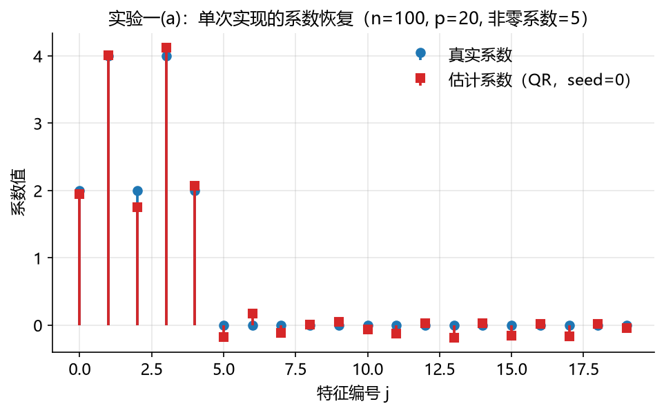
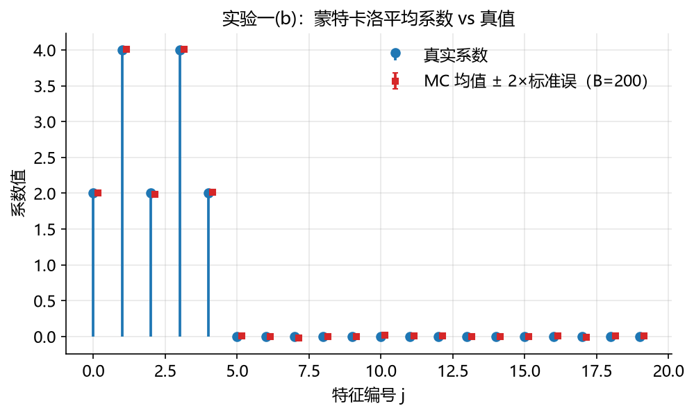
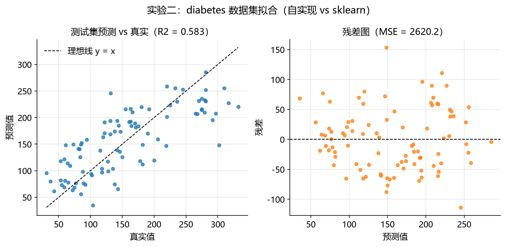
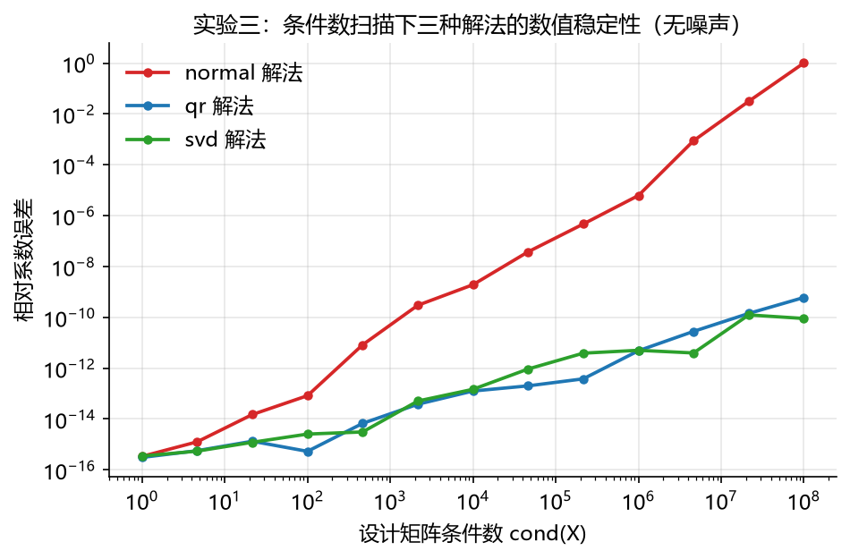

# 01-least-squares 最小二乘法（OLS）

最小二乘法（OLS）是线性模型拟合的基石（对应主 README §2.1），也是本仓库第一个方法学习模块。它本身并不执行变量选择——但其"不稀疏、方差膨胀"两大局限，正是后续变量选择方法发展的出发点。本文档按"背景与动机 → 数学原理 → 算法步骤 → 实现讲解 → 实验设计与结果分析 → 复现方式 → 关联文献"七段展开；配套代码见 [`ols.py`](ols.py)（从零实现，逐段讲解）与 [`experiment.py`](experiment.py)（三组可复现实验）。

## 1. 背景与动机

### 1.1 要解决的问题

18 世纪末的天文学家面临一个共同困境：观测仪器总有误差，同一颗彗星会被不同观测者、不同时刻的记录给出互相矛盾的位置。当**方程数多于未知数**时（$n$ 个观测方程、$p$ 个待求轨道参数，$n>p$），没有任何一组参数能让所有方程同时精确成立——必须回答：怎样从互相矛盾的数据中取出"最优"答案？

Legendre 在 1805 年出版的《计算彗星轨道的新方法》附录中给出了回答：**让误差的平方和最小**。这就是最小二乘法（méthode des moindres quarrés）。

### 1.2 诞生背景：两条独立的发现路线

- **Legendre（代数路线）**：从"如何度量总体误差"出发。绝对值和虽直观但不可导、难求解；平方和处处可导，求导后化为线性方程组——简洁、可操作，但他讲不清"为什么偏偏最优"。
- **Gauss（概率路线）**：1809 年在《天体运动论》中把最小二乘与误差概率模型、最大似然联系起来，推动了正态误差模型在测量误差分析中的使用（正态分布在 Lagrange、Laplace 等人手中已有雏形，并非 Gauss 一人奠定）。Gauss 同时声称自己自 1795 年起便在使用此法，与 Legendre 的 1805 年公开发表形成著名的优先权争议；通常将公开发表优先权归于 Legendre，而 Gauss 的早期使用主张至今未有定论（史实梳理见 [53][54]）。
- **最优性定理的成形**：Gauss 在 1821–1823 年的误差理论工作中证明了正态误差下最小二乘的最优性；Markov 于 1912 年将结果推广到不依赖正态假定的线性无偏估计类，形成今天所称的 **Gauss–Markov 定理**（现代标准表述见 [55][56]）。

### 1.3 为什么它是"变量选择"的起点

最小二乘给出了"用数据拟合线性模型"的标准答案，但它有两个天然局限：**不产生稀疏解**（所有系数一般均非零，见 §5.1 实验一），以及 **$p$ 增大时过拟合、方差膨胀**。此后两百年的一系列方法——逐步回归、Ridge、Lasso、非凸惩罚——都可以看作是在保留最小二乘精神（拟合数据）的同时修补这两个局限。理解 OLS 是理解后续全部方法的地基。

## 2. 数学原理

### 2.1 问题设定与目标函数

给定设计矩阵 $X\in\mathbb{R}^{n\times p}$（$n$ 个样本、$p$ 个特征，列满秩）与响应 $y\in\mathbb{R}^n$，线性模型为

$$
y = X\beta + \varepsilon \tag{1}
$$

其中 $\beta\in\mathbb{R}^p$ 为待估系数，$\varepsilon$ 为误差。本节及 §2.4 的无偏性讨论默认条件 $E[\varepsilon\mid X]=0$（误差条件零均值）。最小二乘准则为最小化残差平方和：

$$
S(\beta) = \|y - X\beta\|_2^2 = (y - X\beta)^\top (y - X\beta) \tag{2}
$$

### 2.2 正规方程

$S(\beta)$ 是 $\beta$ 的凸二次函数，驻点即全局最小。对 $\beta$ 求梯度：

$$
\nabla_\beta S(\beta) = -2X^\top (y - X\beta) \tag{3}
$$

令其为零，得到**正规方程**（normal equations）：

$$
X^\top X\,\beta = X^\top y \tag{4}
$$

当 $X$ 列满秩时 $X^\top X$ 可逆，解唯一：

$$
\hat\beta = (X^\top X)^{-1} X^\top y \tag{5}
$$

### 2.3 几何解释

最优拟合值 $\hat y = X\hat\beta$ 是 $y$ 在 $X$ 列空间上的正交投影，投影矩阵 $P = X(X^\top X)^{-1}X^\top$；残差 $e = y - \hat y$ 与列空间正交，即

$$
X^\top e = 0 \tag{6}
$$

这正是正规方程的另一种写法：**最优解让残差与每个特征都正交**。

### 2.4 最优性：Gauss–Markov 定理

> **Gauss–Markov 定理**：在误差零均值、同方差、互不相关且 $X$ 固定的条件下，最小二乘估计 $\hat\beta$ 是所有线性无偏估计中方差最小的（Best Linear Unbiased Estimator, BLUE）。

该定理回答"平方和为什么合理"：不需要假设误差分布形态，最小二乘已是线性无偏估计类中的最优者。标准教材表述见 [55][56]。

### 2.5 正态误差下的最大似然等价

若进一步假设 $\varepsilon \sim N(0, \sigma^2 I)$，则对数似然为

$$
\ell(\beta) = -\frac{n}{2}\log(2\pi\sigma^2) - \frac{1}{2\sigma^2}\|y - X\beta\|_2^2 \tag{7}
$$

最大化 $\ell(\beta)$ 等价于最小化 $S(\beta)$——**最小二乘估计即最大似然估计**。这是 Gauss 概率路线的现代表述，也是正态线性模型文献的标准结论（见 [55]）。

### 2.6 解的存在性与唯一性

$X$ 列满秩时解唯一（式 5）。若 $X$ 秩亏（列相关或 $n<p$），正规方程有无穷多解——此时正规方程解法因 $X^\top X$ 数值奇异而失败，QR 的 $R$ 亦奇异，唯有 SVD 配合截断能给出数值稳妥的最小范数解（代码中 `fit_svd` 默认按机器精度自动截断，见 §3 与 §5.3）。

## 3. 算法步骤

1. **中心化**：对 $X$、$y$ 按列/整体去均值。截距项通过对数据中心化实现，等效于设计矩阵加一列 1，但数值更稳（即 Frisch–Waugh–Lovell 定理的特例：中心化等价于对常数列做偏回归，见 [58][59]）；
2. **选择数值解法**（三种路径在精确算术下等价，差别在数值稳定性与适用条件）：

   | 解法 | 公式 | 条件数行为 | 适用条件 |
   | :--- | :--- | :--- | :--- |
   | 正规方程 | $\hat\beta = (X^\top X)^{-1}X^\top y$（式 5） | 误差按 $\mathrm{cond}(X)^2$ 放大；$\kappa^2 \gtrsim 1/\epsilon$ 时进入数值奇异区间（报错或返回垃圾值） | 满列秩、良态 |
   | QR 分解 | $X = QR,\ \hat\beta = R^{-1}Q^\top y$（式 8） | 误差按 $\mathrm{cond}(X)$ 放大 | 满列秩 |
   | SVD | $X = U\Sigma V^\top,\ \hat\beta = V\Sigma^{-1}U^\top y$（式 9） | 误差按 $\mathrm{cond}(X)$ 放大；可截断小奇异值 | 任意秩（截断后为最小范数解） |

   后两种解法的公式编号如下（代码注释中"公式 (8)/(9)"即指此）：

   $$
   \text{QR：}\quad X = QR, \qquad \hat\beta = R^{-1}Q^\top y \tag{8}
   $$

   $$
   \text{SVD：}\quad X = U\Sigma V^\top, \qquad \hat\beta = V\Sigma^{-1}U^\top y \tag{9}
   $$

   （$\Sigma^{-1}$ 中对小于截断阈值的奇异值置 $\infty$，即截断伪逆；数值线性代数经典参考见 [57]。）

3. **求解系数**：解三角/对角系统得到 $\hat\beta$，还原截距；
4. **预测与评估**：$\hat y = X\hat\beta + b$；用 $R^2 = 1 - \mathrm{SS}_{res}/\mathrm{SS}_{tot}$ 与 MSE 评估。

**复杂度**：三种解法均为 $O(np^2 + p^3)$ 量级；构造 $X^\top X$ 需 $O(np^2)$，$p\times p$ 求解/分解需 $O(p^3)$。$n \gg p$ 时差别不大，病态时稳定性差别显著（§5.3 实测）。

## 4. 实现讲解

[`ols.py`](ols.py) 按五段组织，每段对应上文一个知识点：

| 代码段 | 内容 | 对应本文 |
| :--- | :--- | :--- |
| 第 1 段 | 问题设定注释（为何需要最优准则） | §1.1、公式 (1)(2) |
| 第 2 段 `fit_normal_equation` | 正规方程闭式解 | §2.2、公式 (4)(5) |
| 第 3 段 `fit_qr` | QR 分解求解 | §3 步骤 2 |
| 第 4 段 `fit_svd` | SVD 求解（`rcond=None` 时按机器精度默认截断，亦支持显式阈值） | §2.6、§3 步骤 2 |
| 第 5 段 `OLS` 类 | 统一接口（fit/predict/score）+ 截距中心化 | §3 步骤 1、4 |

三点设计说明：

- **三种解法并存**而非只留一种，是为了在 §5.3 中直接对比数值行为；日常使用默认 `solver="qr"`（精度与速度的平衡）；
- **截距用中心化实现**：`fit` 内部对 $X$、$y$ 去均值后拟合，再以 `intercept_ = y_mean - x_mean @ coef_` 还原，避免在设计矩阵中显式添加全 1 列；
- **接口对齐 sklearn**（`fit`/`predict`/`score`，属性名 `coef_`/`intercept_`），使实验二可以直接与 `sklearn.linear_model.LinearRegression` 对拍，用机器精度验证实现正确性。

## 5. 实验设计与结果分析

三组实验由 [`experiment.py`](experiment.py) 一键运行，所有随机种子固定；图表在 `figures/`，数值结果在 `results/`。

**三组实验的分工**：OLS 的正确性有三个维度，本模块各用一组实验验证一个维度，彼此隔离、互不干扰——

| 实验 | 验证的性质 | 手段 |
| :--- | :--- | :--- |
| 一 | 统计性质（无偏性[蒙特卡洛 B=200]、支撑集行为） | 合成数据（真系数已知）+ 200 次重复 |
| 二 | 工程性质（实现正确性、真实数据工作流） | 与 sklearn 对拍 + diabetes 拟合 |
| 三 | 数值性质（病态下的解法差异） | 无噪声 + 条件数受控扫描 |

**评估指标说明**（全文通用，先定义后使用）：

| 指标 | 定义 | 计算方式 | 结果解读 |
| :--- | :--- | :--- | :--- |
| 预测 MSE | $\frac{1}{n}\sum_i (y_i - \hat y_i)^2$ | `lib.metrics.mse(y, y_pred)` | 拟合优度，越小越好；可与噪声方差比较，判断信号捕获程度 |
| 系数 MSE | $\frac{1}{p}\sum_j (\hat\beta_j - \beta_j)^2$ | 同上，输入为估计系数与真系数 | 估计精度；仅真系数已知时可算，小即接近真值 |
| tp / fp / fn | 支撑集交集与差集计数（$\lvert\beta\rvert > 10^{-8}$ 判为非零） | `lib.metrics.support_recovery` | tp=选中的真非零、fp=误选、fn=漏选 |
| precision | $\mathrm{tp}/(\mathrm{tp}+\mathrm{fp})$ | 由 tp/fp/fn 导出 | 选中项的纯度；低说明选入大量无关变量 |
| recall | $\mathrm{tp}/(\mathrm{tp}+\mathrm{fn})$ | 同上 | 真变量的覆盖率；低说明遗漏真实信号 |
| Jaccard | $\mathrm{tp}/(\mathrm{tp}+\mathrm{fp}+\mathrm{fn})$ | 同上 | 综合相似度，$[0,1]$，1 为完全恢复 |
| $R^2$ | $1-\mathrm{SS}_{res}/\mathrm{SS}_{tot}$ | `OLS.score`（与 sklearn 未校正定义一致） | 响应变异中被模型解释的比例，越接近 1 越好 |
| 相对系数误差 | $\lVert\hat\beta-\beta\rVert / \lVert\beta\rVert$ | `np.linalg.norm` 之比 | 实验三专用：无噪声下纯数值误差的度量 |
| 条件数 $\mathrm{cond}(X)$ | $\sigma_{\max}/\sigma_{\min}$ | `np.linalg.cond` | 病态程度；越大，数值误差被放大越严重 |

> **阅读提示**：精度类指标（MSE、$R^2$）回答"拟合得多好"，支撑集类指标（tp/fp/fn 及导出量）回答"变量选得多准"——两者用途不同，不要混用。本模块的 OLS 是稠密方法，支撑集指标在这里的作用是**量化"不稀疏"这一缺陷**，为后续惩罚方法提供对照基线。

### 5.1 实验一：合成稀疏数据上的系数恢复

**设置**：`make_synthetic(n_samples=100, n_features=20, n_informative=5, rho=0.3, noise_std=1.0, seed=0)`，QR 解法。真系数前 5 个非零（值在 2 与 4 间交替），其余 15 个为 0。选用合成数据是因为支撑集指标需要已知真系数作为基准——真实数据没有 ground truth，只能评估预测精度、无法评估"选得准不准"。

| 指标 | 数值 |
| :--- | :--- |
| tp / fp / fn | 5 / 15 / 0 |
| precision | 0.250 |
| recall | 1.000 |
| Jaccard | 0.250 |
| 系数 MSE（对真系数） | 0.0136 |
| 预测 MSE | 0.8129 |



**无偏性的蒙特卡洛验证**：单次模拟无法验证无偏性——无偏性是重复实验的均值性质。固定数据生成过程、仅更换随机种子（0–199）重复 $B=200$ 次：

| 指标 | 数值 |
| :--- | ---: |
| 平均绝对偏差（MC） | 0.0085 |
| 最大绝对偏差（MC） | 0.0210 |
| 系数平均标准差（MC） | 0.1241 |
| MC 标准误量级（SD/√B） | 0.0088 |



平均绝对偏差 0.0085 与标准误量级 0.0088 同阶——与 0 在统计上不可区分，且远小于系数自身的离散程度（平均 SD 0.1241），实证支持 §2.4 的无偏性。

**分析（单次实现）**：估计系数与真值整体接近（系数 MSE 仅 0.0136），但**全部 20 个系数都被估成了非零**——recall = 1 而 precision 仅 0.25。这不是实现缺陷，而是 OLS 的固有性质：对随机连续设计，闭式解的系数几乎必然不为零（精确零仅在测度为零的特殊设计下出现）。**"选不出稀疏解"正是变量选择问题存在的理由**，也是本仓库后续方法（从 Ridge、Lasso 到非凸惩罚）要解决的问题。注意真实支撑集被 100% 命中（fn=0），说明信号足够强时 OLS 至少"不遗漏"。

### 5.2 实验二：diabetes 真实数据拟合与 sklearn 对拍

**设置**：sklearn 内置 diabetes 数据（442 样本、10 特征，来源见 §7 文献 [24]），按 `seed=42` 随机划分 350 训练 / 92 测试，QR 解法、估计截距。

| 指标 | 数值 |
| :--- | :--- |
| 训练 $R^2$ | 0.497 |
| 测试 $R^2$ | 0.583 |
| 测试 MSE | 2620.2 |
| 与 sklearn 最大系数差 | 1.14e-12 |
| 与 sklearn 截距差 | 0.0 |



**分析**：自实现与 sklearn 的系数差异在 1e-12 量级（双精度机器精度），**实现正确性得到独立验证**。测试 $R^2$（0.583）高于训练 $R^2$（0.497）是单次随机划分下的抽样波动（测试集仅 92 个样本），不代表泛化规律。残差整体围绕 0 分布、未见明显系统性弯曲，但方差随预测值增大有轻微增大趋势——这是引入加权或稳健回归的常见动机，超出本文范围。

### 5.3 实验三：条件数扫描下的数值稳定性

**设置**：构造 $n=200, p=10$ 的无噪声数据，奇异值从 1 线性降到 $1/\kappa$，使条件数 $\kappa$ 从 $10^0$ 扫到 $10^8$；以相对系数误差 $\|\hat\beta-\beta\|/\|\beta\|$ 衡量三种解法（无噪声，误差纯来自数值计算）。

| $\mathrm{cond}(X)$ | normal | qr | svd |
| :--- | ---: | ---: | ---: |
| $10^0$ | 3.4e-16 | 3.1e-16 | 3.5e-16 |
| $10^2$ | 1.5e-14 | 1.3e-15 | 1.2e-15 |
| $10^4$ | 3.8e-08 | 2.0e-13 | 9.2e-13 |
| $10^6$ | 6.2e-06 | 4.8e-12 | 5.0e-12 |
| $10^8$ | 1.009 | 6.0e-10 | 9.0e-11 |



**分析**：结果与理论精确吻合——正规方程解法先形成 $X^\top X$，条件数被平方（$\kappa^2$：从 $10^0$ 到 $10^8$ 时误差从 1e-16 涨到 1.0，解已完全失真）；补充边界测试进一步发现，当 $\kappa^2$ 超过双精度倒数（约 $4.5\times10^{15}$，即 $\kappa \gtrsim 7\times10^{7}$）时，$X^\top X$ 进入数值奇异区间——LAPACK 可能直接抛出 `LinAlgError`，也可能不报错但返回完全错误的结果（实测 $\kappa=10^{10}$ 时相对误差约 1.0）：正规方程在强病态下不是"变差"而是"失效"。QR 与 SVD 不放大条件数，误差仅按 $\mathrm{cond}(X)$ 线性增长，全程保持在 1e-9 以下。**结论：病态问题（特征强相关）务必使用 QR 或 SVD，不要直接解正规方程**。这一教训同样适用于后续带惩罚的回归问题：应避免不必要地形成 $X^\top X$，并按算法选择恰当的数值线性代数工具（见 [57]）。

### 5.4 小结

三组实验分别验证了：OLS 的统计性质（无偏、满支撑）、工程性质（与标准库机器精度一致）与数值性质（解法选择决定病态下的成败）。它们共同构成本仓库后续所有方法模块的实验范式。

## 6. 复现方式

环境：Python ≥ 3.9，依赖见仓库根目录 `requirements.txt`。

```bash
pip install -r requirements.txt
python methods/01-least-squares/experiment.py
```

输出：`figures/` 下 4 张图（150 dpi PNG，由 `lib/plotting.py` 统一样式自动生成），`results/` 下 6 个结果文件（2 个 JSON 汇总 + 4 个 CSV 明细）。脚本与所在目录无关，可从任意工作目录运行；图表与数值均可由上述命令一键再生。

## 7. 关联文献

编号对应主 README §4 参考文献题录；方括号内为文献在本模块中的角色。

1. Legendre, A. M. (1805). *Nouvelles méthodes pour la détermination des orbites des comètes*（附录首次发表并命名最小二乘法）。［题录已核验，PDF 待补］
2. Gauss, C. F. (1809). *Theoria motus corporum coelestium in sectionibus conicis solem ambientium*（最小二乘与误差概率模型的早期联系）。［题录已核验，PDF 待补］
3. Fisher, R. A. (1936). The use of multiple measurements in taxonomic problems. *Annals of Eugenics* 7(2): 179–188.［[PDF](../../papers/Fisher_1936_MultipleMeasurements.pdf)；同属主 README §2.1 思想萌芽期，本模块未使用其内容，列此供延伸阅读］
24. Efron, B., Hastie, T., Johnstone, I., & Tibshirani, R. (2004). Least angle regression. *Annals of Statistics* 32(2): 407–499（实验二 diabetes 数据来源；另见 scikit-learn 数据集文档 https://scikit-learn.org/stable/datasets/toy_dataset.html#diabetes-dataset）。［[PDF](../../papers/Efron_Hastie_Johnstone_Tibshirani_2004_LeastAngleRegression.pdf)］
53. Stigler, S. M. (1981). Gauss and the invention of least squares. *The Annals of Statistics* 9(3): 465–474.［[PDF](../../papers/Stigler_1981_GaussInventionLeastSquares.pdf)；Legendre–Gauss 优先权争议专文，支撑 §1.2］
54. Plackett, R. L. (1972). Studies in the history of probability and statistics. XXIX: The discovery of the method of least squares. *Biometrika* 59(2): 239–251.［题录已核验，PDF 待补；最小二乘发现史的标准专文］
55. Seber, G. A. F., & Lee, A. J. (2003). *Linear Regression Analysis* (2nd ed.). Hoboken: Wiley.［题录已核验，PDF 待补；Gauss–Markov 定理与正态线性模型的标准教材表述，支撑 §2.4/§2.5］
56. Rao, C. R. (1973). *Linear Statistical Inference and Its Applications*. New York: Wiley.［题录已核验，PDF 待补；Gauss–Markov 定理的经典陈述］
57. Golub, G. H., & Van Loan, C. F. (2013). *Matrix Computations* (4th ed.). Baltimore: Johns Hopkins University Press.［题录已核验，PDF 待补；QR/SVD/条件数等数值线性代数内容，支撑 §3/§5.3］
58. Frisch, R., & Waugh, F. V. (1933). Partial time regressions as compared with individual trends. *Econometrica* 1(4): 387–401.［题录已核验，PDF 待补］
59. Lovell, M. C. (1963). Seasonal adjustment of economic time series and multiple regression analysis. *Journal of the American Statistical Association* 58(304): 993–1010.［题录已核验，PDF 待补；58+59 合称 Frisch–Waugh–Lovell 定理，支撑 §3 步骤 1 的中心化等价性］
