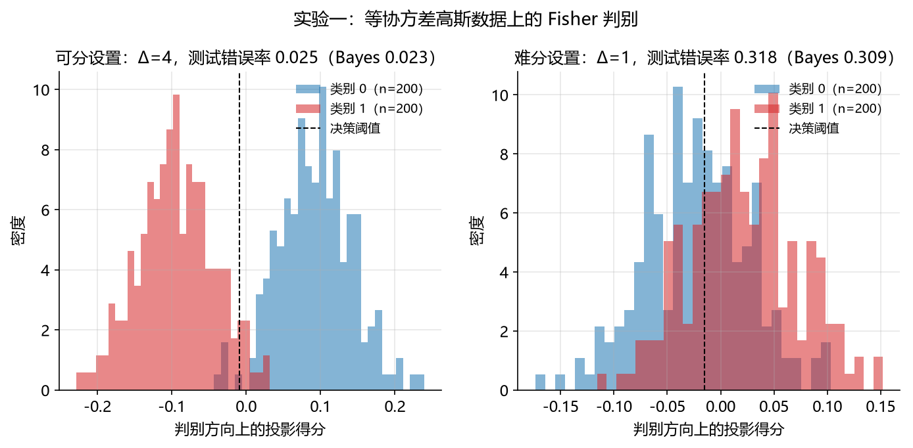
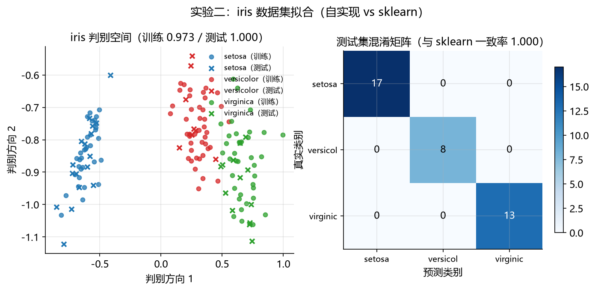
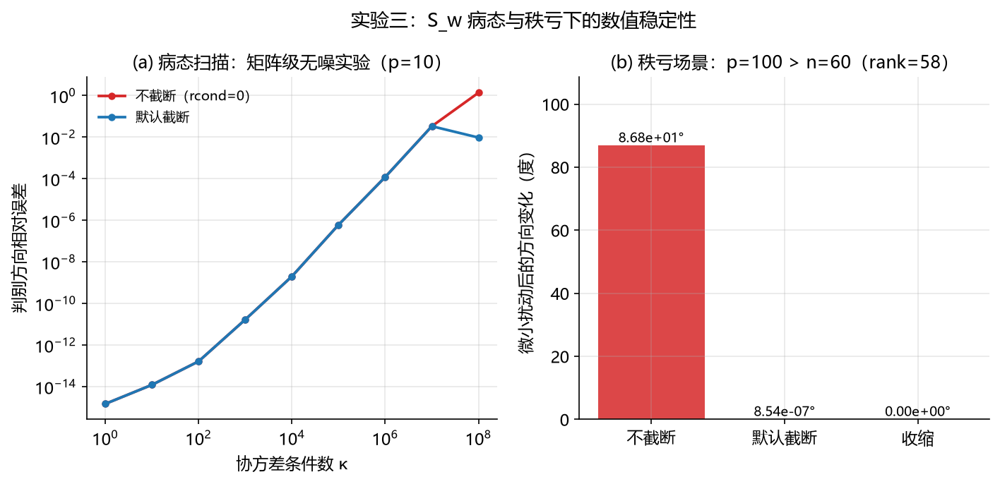

# 02-fisher-discriminant Fisher 判别分析（FDA）

Fisher 判别分析是变量选择方法发展脉络中第一个**分类**方法（对应主 README §2.1 时间线第二项，Fisher 1936），也是本仓库第二个方法学习模块。它回答的问题：$p$ 个测量如何组合成一个"最有利于分类"的低维投影。本文档按"背景与动机 → 数学原理 → 算法步骤 → 实现讲解 → 实验设计与结果分析 → 复现方式 → 关联文献"七段展开；配套代码见 [`fda.py`](fda.py)（从零实现，逐段讲解）与 [`experiment.py`](experiment.py)（三组可复现实验）。

## 1. 背景与动机

### 1.1 要解决的问题

分类问题给定 $n$ 个带标签样本 $(x_i, y_i)$（$x_i\in\mathbb{R}^p$，$y_i\in\{1,\dots,K\}$），要建立从特征到类别的决策规则。当 $p$ 较大时，直接在高维空间比较"距离"或"相似度"既难计算也难解释。Fisher (1936) 在分类学问题中提出：**先把 $p$ 个测量线性组合成一个（或 $K-1$ 个）标量投影，再在投影空间上分类**。判据是类间散度尽量大、类内散度尽量小——分类误差本质上取决于类间差异与类内变差的对比。

### 1.2 诞生背景

Fisher (1936) 研究的是生物分类中的多重测量问题：如何组合多个测量指标，把物种可靠地区分开。论文以鸢尾花（iris）数据作为经典示例——该数据由 Edgar Anderson 于 1935 年采集（[61]），Fisher 对其完成了系统的判别分析（[3]），如今经 scikit-learn 分发（§5.2 实验即使用它）。这是多重测量分类问题最早、最具影响力的系统性处理之一，也是 Fisher 所引领的 20 世纪统计革命（似然、充分性、方差分析、实验设计）在分类方向的落点。与上一模块的最小二乘对比：OLS 处理**回归**（响应连续），Fisher 判别处理**分类**（响应离散），两者共同构成线性模型的两大基本范式。

### 1.3 为什么重要

- **理论源头**：它是线性判别分析（LDA）的理论原型——Fisher 的推导不依赖分布假设、只优化散度比；LDA 加上正态、等协方差假设后给出概率解释。在共同协方差高斯模型、相同的协方差估计与类别先验设定下，两者的判别方向一致（对应关系的分层说明见 §2.4）；
- **降维可视化的源头**："找使类间/类内比最大的投影"是主成分分析之外另一条降维路线，判别方向至今是高维数据可视化的标准工具；
- **与回归的对应**：两类时 Fisher 方向与对 0/1 类别指示变量做 OLS 的斜率方向精确成比例（本文 §2.5 给出推导，数值验证见下），把本模块与 01-least-squares 模块直接连通。

## 2. 数学原理

### 2.1 问题设定与散度矩阵

记第 $k$ 类的样本集为 $C_k$，样本数 $n_k$、先验 $\pi_k = n_k/n$、类均值 $\mu_k$、总均值 $\mu = \sum_k \pi_k \mu_k$：

$$
\pi_k = \frac{n_k}{n}, \qquad \mu_k = \frac{1}{n_k}\sum_{i\in C_k} x_i, \qquad \mu = \sum_{k=1}^{K}\pi_k\,\mu_k \tag{1}
$$

定义两类散度矩阵：

$$
S_w = \sum_{k=1}^{K}\ \sum_{i\in C_k} (x_i - \mu_k)(x_i - \mu_k)^\top, \qquad
S_b = \sum_{k=1}^{K} n_k\,(\mu_k - \mu)(\mu_k - \mu)^\top \tag{2}
$$

$S_w$ 度量类内离散（$p\times p$ 半正定），$S_b$ 度量类间分离（秩至多 $K-1$）。

### 2.2 Fisher 准则与两分类解

对单位方向 $w$，投影后的类间/类内散度比为**广义瑞利商**：

$$
J(w) = \frac{w^\top S_b\, w}{w^\top S_w\, w} \tag{3}
$$

最大化 $J(w)$ 即得 Fisher 判别方向。两类时 $S_b$ 秩为 1，代入 (3) 可直接解出闭式形式：

$$
w^\ast \propto S_w^{-1}(\mu_1 - \mu_2) \tag{4}
$$

**几何解释**：$\hat y = X\hat\beta$ 是 $y$ 在 $X$ 列空间上的正交投影——OLS 让残差与列空间正交；Fisher 则让投影后的类均值差相对于类内标准差最大，即信噪比最大的方向。

### 2.3 多类推广

$K>2$ 时单方向不够用。最大化瑞利商等价于广义特征值问题：

$$
S_b\, v_j = \lambda_j\, S_w\, v_j, \qquad j = 1, \dots, \min(p, K-1) \tag{5}
$$

取前 $m$ 个特征向量构成投影矩阵 $W$（$p\times m$）。由于 $\operatorname{rank}(S_b)\le\min(p,\,K-1)$，**有效判别方向至多 $\min(p,K-1)$ 个**——这就是“判别分析最多 $K-1$ 维”的由来（多类判别函数与多个判别方向的系统阐述见 Rao (1948) [62]）。

### 2.4 决策规则

投影方向回答"往哪投"，分类还需要决策规则。在正态、等协方差假设下（$\Sigma = S_w/(n-K)$ 为合并协方差估计），后验概率的对数是 $x$ 的线性函数：

$$
\delta_k(x) = x^\top \Sigma^{-1}\mu_k - \tfrac{1}{2}\,\mu_k^\top \Sigma^{-1}\mu_k + \log \pi_k, \qquad \hat y = \arg\max_k \delta_k(x) \tag{6}
$$

注意 (6) 与 (4)(5) 使用同一个 $\Sigma$，但两者回答的问题不同，应当分层理解：**判别方向**（公式 4/5）由 Fisher 准则确定，不依赖任何分布假设；**决策规则**（公式 6）则依赖正态、等协方差假设，且阈值取决于类别先验 $\pi_k$ 与误分类代价的设定。因此更准确的说法是：在共同协方差高斯模型、相同协方差估计与相同先验/代价设定下，Fisher 方向与 LDA 的线性判别方向一致，LDA 进一步提供后验概率形式的决策规则；改变先验或代价会改变决策边界，但不改变判别方向。本模块代码中的 `linear_scores` 使用经验先验的 $\log\pi_k$，实现的即是 LDA 型决策规则，而非 Fisher 准则本身。

### 2.5 与 OLS 的对应

在**两类、含截距项、$S_w$ 满秩、无正则化/截断**的普通最小二乘设定下，对 0/1 类别指示变量 $z_i$ 做 OLS，斜率向量 $\hat\beta_{z}$ 与 Fisher 方向成比例：$\hat\beta_{z} \propto S_w^{-1}(\mu_1-\mu_2)$。直观解释：OLS 用特征去“解释”类别取值，解释力的方向正是类间差异相对于类内离散最大的方向。需要留意：这一等价关系依赖上述条件——一旦启用收缩、截断或 $S_w$ 秩亏（§5.3 的情形），两侧采用不同的稳定化机制，等价关系不再精确成立。数值验证（等样本量与不等样本量两种情形，默认参数）两者夹角的 $|\cos| = 1.000000$，可在任意环境复现：

```python
z = y.astype(float)                                  # 0/1 指示变量
A = np.hstack([np.ones((len(z), 1)), X])
beta_z = np.linalg.lstsq(A, z, rcond=None)[0][1:]    # 去截距的斜率部分
```

## 3. 算法步骤

1. **类别统计**：估计 $\pi_k$、$\mu_k$ 与总均值 $\mu$；
2. **计算散度矩阵** $S_w$、$S_b$（式 2）；
3. **解广义特征值问题**：白化 $S_w$ 后化为标准对称特征值问题 $(S_w^{-1/2}S_b S_w^{-1/2})u = \lambda u$，再变换回 $v = S_w^{-1/2}u$；按 $rcond$ 截断数值零特征值（默认按机器精度，与 01-least-squares 模块 `fit_svd` 的默认策略一致），取前 $m \le K-1$ 个方向；
4. **线性判别函数**：$\Sigma = S_w/(n-K)$，逐类解 $\Sigma^{-1}\mu_k$ 得 (6) 的系数与截距；
5. **预测与评估**：$\arg\max_k \delta_k(x)$；用准确率、平衡准确率、混淆矩阵评估。

**复杂度**：散度矩阵计算 $O(np^2)$，$p\times p$ 对称特征值分解 $O(p^3)$，总体 $O(np^2 + p^3)$——与 OLS 同量级。**数值要点**：$S_w$ 在 $p>n$ 或特征强相关时奇异/病态，白化放大舍入误差，必须截断或收缩（§5.3 实测）。

## 4. 实现讲解

[`fda.py`](fda.py) 按五段组织，每段对应上文一个知识点：

| 代码段 | 内容 | 对应本文 |
| :--- | :--- | :--- |
| 第 1 段 `class_statistics` / `scatter_matrices` | 类别统计与散度矩阵 | §2.1、公式 (1)(2) |
| 第 2 段 `fit_two_class` | 两分类闭式解 | §2.2、公式 (4) |
| 第 3 段 `solve_directions` | 白化 + 广义特征值 + 截断 | §2.3、公式 (5) |
| 第 4 段 `shrink_sw` / `linear_scores` | 收缩稳定化与线性判别函数 | §2.4、公式 (6) |
| 第 5 段 `FisherDiscriminant` 类 | 统一接口（fit/transform/decision_function/predict/score） | §3 |

三点设计说明：

- **接口与属性名对齐 sklearn `LinearDiscriminantAnalysis`**（`scalings_`、`explained_variance_ratio_`、`coef_`、`intercept_` 等），使实验二可以直接对拍，用机器精度验证实现正确性；
- **秩亏处理内置**：白化时按 $rcond$ 截断数值零特征值（剔除方向权重置 0 而非 inf），天然给出最小范数行为——这是文档承诺与代码行为一致的关键（01-least-squares 模块评审后同样的加固策略）；
- **收缩参数 `reg`**：向 $S_w$ 加各向同性项，$reg>0$ 即正定；$reg=0$ 时不收缩，与截断策略可叠加使用。作为统计方法，收缩判别分析（RDA）的系统阐述见 Friedman (1989) [63]；本模块采用的是其最简形式（各向同性收缩），目的是数值稳定化，而非复现该文包含协方差特征值收缩的完整方法。

## 5. 实验设计与结果分析

三组实验由 [`experiment.py`](experiment.py) 一键运行，所有随机种子固定；图表在 `figures/`，数值结果在 `results/`。

**三组实验的分工**：FDA 的正确性有三个维度，各用一组实验验证一个维度，彼此隔离——

| 实验 | 验证的性质 | 手段 |
| :--- | :--- | :--- |
| 一 | 统计性质（方向一致性、精度与 Bayes 最优的关系） | 合成等协方差高斯数据，真值解析 |
| 二 | 工程性质（实现正确性、真实数据工作流） | iris 与 sklearn LDA 对拍 |
| 三 | 数值性质（病态与秩亏下的稳定性） | 矩阵级无噪扫描 + p>n 扰动测试 |

**评估指标说明**（全文通用，先定义后使用）：

| 指标 | 定义 | 计算方式 | 结果解读 |
| :--- | :--- | :--- | :--- |
| 分类准确率 | 预测正确的样本比例 | `lib.metrics.accuracy` | 整体判对比例；类别不平衡时有偏 |
| 平衡准确率 | 各类召回率的宏平均 | `lib.metrics.balanced_accuracy` | 对类别不平衡更稳健 |
| 混淆矩阵 | 行=真实类别、列=预测类别的计数表 | `lib.metrics.confusion_matrix` | 看哪两类互相混淆 |
| 判别方向夹角 | $\arccos\lvert\cos\langle \hat w, w^\ast\rangle\rvert$ | 实验一 | 估计方向与真实方向的一致性，0 为一致 |
| 判别方向相对误差 | $\lVert \hat w/\lVert\hat w\rVert - w^\ast/\lVert w^\ast\rVert\rVert$ | 实验三（归一化，对尺度不变） | 方向偏差；特征向量只确定到符号与尺度，故先归一化 |
| 扰动后方向变化 | 数据加 $10^{-10}$ 扰动重新拟合后的夹角 | 实验三 | 数值可靠性；接近 0 为稳定，接近 90° 为舍入噪声驱动 |
| 类内散度矩阵条件数 | $\lambda_{\max}/\lambda_{\min}(S_w)$ | `np.linalg.cond` | 病态程度；白化按条件数平方放大误差 |
| 解释方差比 | $\lambda_j / \sum_j \lambda_j$ | `explained_variance_ratio_` | 各判别方向解释的类间方差比例 |

> **阅读提示**：精度类指标（准确率、平衡准确率、混淆矩阵）回答"分得准不准"，方向类指标（夹角、相对误差、扰动角）回答"方向估计得可不可靠"，两者用途不同，不要混用。

### 5.1 实验一：合成等协方差高斯数据（统计性质）

**设置**：两类、$p=5$、共享协方差 $\Sigma = I$；以马氏距离 $\Delta = \lVert\mu_1-\mu_2\rVert_\Sigma$ 控制可分度（可分 $\Delta=4$ / 难分 $\Delta=1$），训练各类 200 个、测试各类 2000 个，种子固定。等协方差高斯下 Bayes 判别即 LDA；在两类**等先验、等误分类代价**时错误率有解析形式 $\Phi(-\Delta/2)$（本实验两类样本数相同，满足该条件）；$\Sigma=I$ 时总体 Fisher 方向与 $(\mu_1-\mu_2)$ 同向。

| 指标 | 可分设置（Δ=4） | 难分设置（Δ=1） |
| :--- | ---: | ---: |
| 判别方向夹角 | 3.37° | 8.25° |
| 训练准确率 | 0.970 | 0.673 |
| 测试错误率 | 0.025 | 0.318 |
| Bayes 错误率 $\Phi(-\Delta/2)$ | 0.023 | 0.309 |



**分析**：两个设置下测试错误率都与 Bayes 错误率高度吻合（0.025 vs 0.023；0.318 vs 0.309）——在本次等协方差高斯模拟中，估计的 Fisher/LDA 分类器表现接近理论下限（单次模拟存在 Monte Carlo 波动，量级约 $10^{-3}$，逐次结果见 `results/exp1_metrics.csv`）。方向夹角随可分度下降而变大（3.37° → 8.25°），符合预期：信号弱时类内噪声对方向估计的干扰更大。注意 Fisher 判别的优势建立在“等协方差”假设上；若两类协方差差异显著（如一个类拉长、一个类紧凑），单方向不再最优，需要二次判别（QDA）或对特征做变换——这是本模块结论的适用边界。

### 5.2 实验二：iris 真实数据与 sklearn 对拍（工程性质）

**设置**：iris 数据集（150 样本、3 类各 50 个、4 特征；Anderson (1935) 采集、Fisher (1936) 经典分析、sklearn 分发），按 `seed=42` 随机划分 112 训练 / 38 测试，默认参数（不收缩、默认截断）。

| 指标 | 数值 |
| :--- | ---: |
| 与 sklearn 预测一致率 | 1.000 |
| 判别方向一致性（\|cos\|，前两个方向） | 1.0 / 1.0 |
| 解释方差比（前两个方向） | 0.993 / 0.007 |
| 解释方差比与 sklearn 最大差 | 1.11e-16 |
| 训练准确率 | 0.973 |
| 测试准确率 / 平衡准确率 | 1.000 / 1.000 |



**分析**：预测 100% 一致、判别方向完全一致（$|\cos|=1$）、解释方差比机器精度一致（1.11e-16）——**本实现与 sklearn 这一标准实现的数值一致性得到验证**（sklearn 是另一套独立实现而非理论真值，故该证据支持“实现与标准实现相符”，不直接支持方法在一般数据上的有效性）。补充诊断（写入实验脚本注释与结果文件）：二分类子集上，两者的分数差精确相差一个仿射变换（拟合残差 1e-15），尺度因子约为 $n/(n-K)$，源于 sklearn 内部合并协方差的除数约定；多分类下 sklearn `decision_function` 采用与逐类高斯对数后验不同的归一化约定，因此 `coef_` 数值不直接可比（原始差 17.08）——**对拍判据应取预测一致率、方向一致性与解释方差比，而非 `coef_` 数值**。测试集 38 个样本全部判对（混淆矩阵对角 17/8/13），iris 对该方法是"简单"数据集，不宜据此推广到难题。

### 5.3 实验三：S_w 病态与秩亏下的数值稳定性（数值性质）

两个场景对应两种失效模式：

**(a) 病态（满秩但条件数极大）——矩阵级无噪实验**：直接构造 $S_w = 2n\,V\mathrm{diag}(s^2)V^\top$（$s$ 从 1 对数降到 $1/\kappa$，使 $\mathrm{cond}(S_w)=\kappa^2$ 精确受控），均值差仅取前 3 个特征方向的分量（保证真方向在扫描范围内始终可恢复），总体方向有解析解 $w^\ast = S_w^{-1}d$。无抽样噪声，误差纯来自数值计算——与 01-least-squares 模块实验三同法。

| $\kappa$ | 不截断 | 默认截断 |
| :--- | ---: | ---: |
| $10^0$ | 1.45e-15 | 1.45e-15 |
| $10^4$ | 1.98e-09 | 1.98e-09 |
| $10^6$ | 1.19e-04 | 1.19e-04 |
| $10^7$ | 3.30e-02 | 3.30e-02 |
| $10^8$ | 1.35 | **9.42e-03** |

**(b) 秩亏（$p>n$）——数据级实验**：$p=100$、每类 30 个样本，$S_w$ 秩为 58（满秩 100），必然奇异。对特征加 $10^{-10}$ 量级微小扰动后重新拟合，以方向变化衡量数值可靠性：

| 策略 | 扰动后方向变化 | 方向相对误差（对真值） |
| :--- | ---: | ---: |
| 不截断（rcond=0） | **86.83°** | 1.19 |
| 默认截断 | **8.54e-07°** | 1.29 |
| 收缩（reg=0.3） | **0.00°** | 0.97 |

理论参考：真方向在 $S_w$ 行空间之外的分量不可恢复，仅秩亏一项的方向误差极限为 0.63；实测各策略的方向误差（0.97–1.29）均高于该极限，因为每方向上的类均值差估计本身还有抽样噪声（$n=30$ 时信噪比不足）。



**分析**：场景 (a) 复现了与 OLS 模块同构的数值规律——白化按条件数**平方**放大误差（$\kappa$ 每涨 10 倍误差涨约 100 倍：$10^4$ 时 2e-9 → $10^6$ 时 1.2e-4 → $10^8$ 时 1.35）；$\kappa \le 10^7$ 时截断尚未触发，两者相同；$\kappa=10^8$ 时最小特征值跌破机器精度，默认截断将其剔除，误差比不截断好**两个数量级**。场景 (b) 揭示更深的失效模式：不截断解由舍入噪声驱动，对 $10^{-10}$ 量级扰动剧烈翻转（86.8°，接近正交）——**它不是"略有偏差"，而是数值上不可信**；截断与收缩则完全稳定（$10^{-7}$° 与 0°）。**结论：$S_w$ 病态或秩亏时务必启用截断（默认）或收缩，绝不使用不截断白化**；高维（$p$ 接近或超过 $n$）时还应认识到，无论何种正则化，方向误差都存在由秩与抽样噪声决定的下限。

## 6. 复现方式

环境：Python ≥ 3.9，依赖见仓库根目录 `requirements.txt`。

```bash
pip install -r requirements.txt
python methods/02-fisher-discriminant/experiment.py
```

输出：`figures/` 下 3 张图（150 dpi PNG，由 `lib/plotting.py` 统一样式自动生成），`results/` 下 6 个结果文件（3 个 JSON 汇总 + 3 个 CSV 明细）。脚本与所在目录无关，可从任意工作目录运行；图表与数值均可由上述命令一键再生。

## 7. 关联文献

编号对应主 README §4 参考文献题录；方括号内为文献在本模块中的角色。

3. Fisher, R. A. (1936). The use of multiple measurements in taxonomic problems. *Annals of Eugenics* 7(2): 179–188.［[PDF](../../papers/Fisher_1936_MultipleMeasurements.pdf)；本模块的起源文献，iris 数据的出处，文档 §1 可对照阅读］
60. Hastie, T., Tibshirani, R., & Friedman, J. (2009). *The Elements of Statistical Learning* (2nd ed.). New York: Springer. DOI: [10.1007/978-0-387-84858-7](https://doi.org/10.1007/978-0-387-84858-7).［题录已核验，PDF 待补；§2 数学原理与 §5 评估指标的教材级参考（判别分析见第 4 章）］
61. Anderson, E. (1935). The irises of the Gaspé Peninsula. *Bulletin of the American Iris Society*, 59: 2–5.［iris 数据原始来源；历史公报，无 DOI 与电子版，“PDF 不适用”］
62. Rao, C. R. (1948). The utilization of multiple measurements in problems of biological classification. *Journal of the Royal Statistical Society, Series B*, 10(2): 159–193. DOI: [10.1111/j.2517-6161.1948.tb00008.x](https://doi.org/10.1111/j.2517-6161.1948.tb00008.x).［题录已核验，PDF 待补；多类判别函数与多个判别方向的经典来源，支撑 §2.3］
63. Friedman, J. H. (1989). Regularized discriminant analysis. *Journal of the American Statistical Association*, 84(405): 165–175. DOI: [10.1080/01621459.1989.10478752](https://doi.org/10.1080/01621459.1989.10478752).［题录已核验，PDF 待补；正则化判别分析（RDA）来源，支撑 §2.4/§4 的收缩讨论］

数据来源：iris 数据由 Anderson (1935) [61] 采集，Fisher (1936) [3] 完成经典判别分析，scikit-learn 负责现代分发（文档见 https://scikit-learn.org/stable/datasets/toy_dataset.html#iris-plants-dataset ）。
