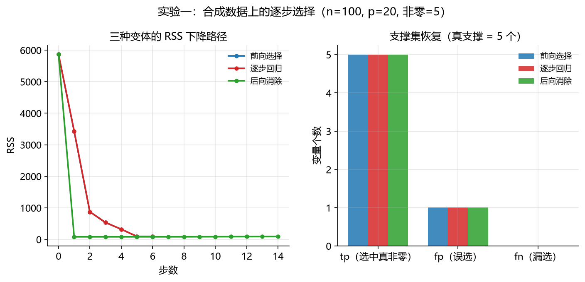
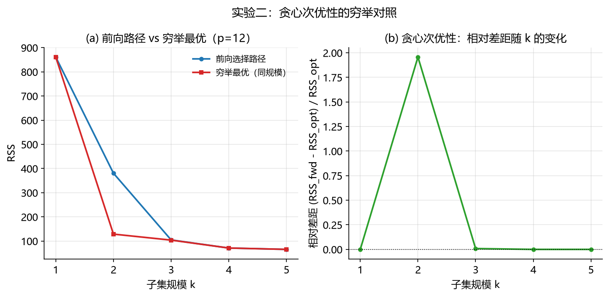
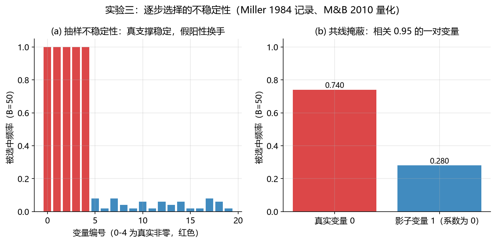

# 03-stepwise-selection 逐步选择法（Stepwise Selection）

逐步选择法是 1960 年代以后最早实现自动化、并随回归软件的普及而成为默认工具的变量选择方法族之一（对应主 README §2.2，算法化筛选时代第一项），也是本仓库第三个方法学习模块。它直接承接 01-least-squares 模块的结论：OLS 对任何设计矩阵都给出满支撑，“选不出稀疏解”正是变量选择问题存在的理由——逐步法就是用自动化搜索来回答这个问题。本文档按“背景与动机 → 数学原理 → 算法步骤 → 实现讲解 → 实验设计与结果分析 → 复现方式 → 关联文献”七段展开；配套代码见 [`stepwise.py`](stepwise.py)（从零实现，逐段讲解）与 [`experiment.py`](experiment.py)（三组可复现实验）。

> **阅读前提与符号约定**：本文档可独立阅读——所有符号在此表定义，实验指标在 §5 评估指标说明表中统一定义，文献引用均为本文档 §7 的局部编号（每条后标注主 README §4 总编号）。未按顺序阅读的读者建议先读 §2（数学原理）再回看 §1；§5 的实验只使用本表符号。前置知识：建议先读 01-least-squares——逐步法每步的内核是 OLS，$n/p/X/y$ 等基础符号与之相同。
>
> | 符号 | 含义 | 定义位置 |
> | :--- | :--- | :--- |
> | $n,\ p$ | 样本数、候选预测变量个数 | §2.1 |
> | $\beta$ | 真实系数向量（数据生成参数；以 $\lvert\beta_j\rvert>10^{-8}$ 判定非零） | §5.1 |
> | $\hat y = X\hat\beta$ | 预测响应 | §2.5 |
> | $S$ | 当前选中的变量子集 | §2.1 |
> | $k = \lvert S\rvert$ | 子集规模 | §2.1 |
> | $\mathrm{RSS}(S)$ | 子集 $S$ 上 OLS 的残差平方和 | §2.1 |
> | $F_{j\mid S}$ | 变量 $j$ 相对子集 $S$ 的偏 $F$ 统计量 | §2.1 |
> | $p_{j\mid S}$ | 偏 $F$ 检验的 $p$ 值 | §2.1 |
> | $p_{\text{in}},\ p_{\text{out}}$ | 进入/剔除阈值（滞回要求 $p_{\text{in}} < p_{\text{out}}$） | §2.4 |
> | $B$ | 实验三的重拟合次数 | §5.3 |
> | Jaccard | 两集合相似度 $\lvert A\cap B\rvert / \lvert A\cup B\rvert$ | §5 指标表 |
> | `selected_`、`history_`、`rss_path_` | 选择器输出的最终子集、每步记录、RSS 路径 | §4 |

## 1. 背景与动机

### 1.1 要解决的问题

给定 $p$ 个候选预测变量，如何**自动化地**挑出一个“够用”的子集？两个约束决定了这道题在 1960 年的形态：其一，计算昂贵，不可能穷举所有 $2^p$ 个子集；其二，判断标准必须可计算——每引入或剔除一个变量，都要有一个统计量说明“值不值”。逐步法把问题化为一条**贪心搜索路径**：从某个端点（空集或全集）出发，每步基于当前模型做一次局部最优决策，直到没有变量值得进出。

### 1.2 诞生背景

- **Efroymson (1960)** 在新兴的“数字计算机数学方法”论文集中给出了前向选择的算法流程——这是“变量筛选可以写成算法”的起点；
- **Draper & Smith (1966)** 的教材《Applied Regression Analysis》把三种变体（前向、后向、逐步）固化为回归分析的标准教学内容，使其成为一代人的默认工具；
- **Beale, Kendall & Mann (1967)** 是早期研究多变量分析中“丢弃变量”及其信息损失的文献；Mantel (1970) 将其转述为“按指定规模保留变量的最佳子集选择”。该文处于变量剔除与子集选择的交汇处（原文未获取，此定位依据其题名与 Mantel 的同时代转述），本仓库不将其作为任一路线的唯一原始文献——全子集搜索的算法源头以 Furnival & Wilson (1974) [4] 与 Hocking (1976) [5] 为准；
- 时代背景方面，同期在模式识别中也出现了“维度增加可能损害泛化性能”的认识（**Hughes 效应**，Hughes (1968) [6] 讨论的是分类问题中的测量精度）；在线性回归中，对应的问题表现为过拟合、方差膨胀与解释困难——变量不是越多越好，筛选有真实收益。

### 1.3 为什么重要，以及它的阴影

逐步法是最早把“变量选择”变成日常实践的算法族之一。今天的正则化方法（Ridge、Lasso）与它面对同一个问题——控制模型复杂度与估计不稳定性——但采用连续收缩/惩罚优化而非离散贪心搜索，是同一问题的不同解法，不是单线继承。它的缺陷则被后续文献系统记录：**Miller (1984/1990)** 系统讨论了回归子集选择方法族（含逐步法）的过拟合、模型规模选择与不稳定性，**Meinshausen & Bühlmann (2010)** 进而把“选择稳定性”本身变成可量化、可控制的对象（§2.6）。本模块的特色正在于把“方法”与“缺陷复现”放进同一条故事线——§5.3 用实验复现不稳定性的两个来源，并给出其成立条件。

## 2. 数学原理

### 2.1 公共内核：子集 OLS 与偏 F 判据

三种变体共享同一个内核。对候选变量的子集 $S$（$|S|=k$），拟合带截距的 OLS（截距经中心化实现：对 $X$、$y$ 去均值后拟合无截距模型，再以 $\bar y - \bar x^\top\hat\beta$ 还原截距），定义残差平方和：

$$
\mathrm{RSS}(S) = \min_{b}\ \|y - X_S b\|_2^2 \tag{1}
$$

把变量 $j$ 加入 $S$ 前后 RSS 的下降量，构成**偏 $F$ 检验**（原假设：$j$ 的系数为零）：

$$
F_{j\mid S} = \frac{\mathrm{RSS}(S) - \mathrm{RSS}(S\cup\{j\})}{1} \Bigg/ \frac{\mathrm{RSS}(S\cup\{j\})}{n - k - 2} \ \sim\ F_{1,\ n-k-2} \tag{2}
$$

所有进出决策都基于这个 $p$ 值的相对大小——判据可计算、可比较，且每步的拟合都是 01 模块的 OLS。

> **适用条件与选择后的解释警告**：上式 $F_{1,\ n-k-2}$ 的成立需要：线性模型设定正确、误差独立同方差（精确有限样本分布还需正态）、设计矩阵视为固定，且**被检验的模型在搜索前已预先指定**。逐步搜索不满足最后一条——前向第一步实际上计算了全部候选的 $p$ 值再取最小者，$p_{\min}=\min_j p_j$ 在原假设下不再服从均匀分布，多步搜索还会继续累积这种多重搜索效应。因此**最终模型中各变量的 $p$ 值不能解释为未经选择的普通 $p$ 值**，$p_{\text{in}}=0.05$ 也不意味着整体误入率为 5%。选择之后的推断需要专门方法（主 README §2.6：同时置信区间 [17]、路径检验 [18]、条件推断 [19][20]），本模块只把 $p$ 值当作搜索的停止准则使用。

### 2.2 前向选择（Forward Selection）

从空模型 $S=\varnothing$ 出发，每步在未入选候选中选 $p$ 值最小者，达到进入阈值则引入：

$$
j^\ast = \arg\min_{j\notin S}\ p_{j\mid S}, \qquad \text{若 } p_{j^\ast\mid S} < p_{\text{in}} \text{ 则 } S \leftarrow S\cup\{j^\ast\} \tag{3}
$$

优点：起点不要求全模型可估计，$p>n$ 时仍可能启动（每步只拟合当前子模型）；代价：早期误入的变量无法被纠正。注意“能启动”不等于“能可靠运行”——它受当前子模型残差自由度与数值秩的约束，且高维下选择稳定性与名义 $p$ 值解释都需额外谨慎（§2.1 的警告在此同样适用）。

### 2.3 后向消除（Backward Elimination）

从全模型 $S=\{1,\dots,p\}$ 出发，每步剔除 $p$ 值最大者，超过剔除阈值则剔除：

$$
j^\ast = \arg\max_{j\in S}\ p_{j\mid S\setminus\{j\}}, \qquad \text{若 } p_{j^\ast\mid S\setminus\{j^\ast\}} > p_{\text{out}} \text{ 则 } S \leftarrow S\setminus\{j^\ast\} \tag{4}
$$

优点：评估的是变量在完整候选模型下的**条件贡献**，与单变量边际关联不同；代价：要求全模型可估计（$n-p-1\ge 1$ 且设计矩阵满列秩），$p\ge n$ 时不可用。注意“条件检验”并非无条件优势——强共线时变量互相替代、条件 $p$ 值可能剧烈变化，且起点（全模型）本身在高维下就已不可靠。

### 2.4 逐步回归（Stepwise Regression，狭义双向变体）

每步依次检查两个动作（经典回归教材中双向逐步回归的标准流程，Draper & Smith (1966) [2] 为代表）：**先查剔除**——已入选者中 $p$ 值最大者是否超过 $p_{\text{out}}$；**再查进入**——未入选者中 $p$ 值最小者是否达到 $p_{\text{in}}$；两者都不满足则收敛：

$$
\text{每步：若 } \max_{j\in S} p_{j\mid S\setminus\{j\}} > p_{\text{out}} \rightarrow \text{剔除该变量；否则若 } \min_{j\notin S} p_{j\mid S} < p_{\text{in}} \rightarrow \text{引入该变量；否则停止} \tag{5}
$$

两个设计要点：

- **滞回（hysteresis）**：$p_{\text{in}} < p_{\text{out}}$（典型 0.05 / 0.10）避免变量“进了又出、出了又进”的震荡；
- **一个要避开的变体**：不要改成“进入者须比当前最差成员更显著”的规则——那会让模型在早期就因成员过于显著而拒绝一切新变量，过早收敛（实现代码第 4 段注释中有说明）。

### 2.5 与 OLS 的关系

OLS 是每步的内核，逐步法是套在外面的**离散搜索**：01 模块回答“给定变量怎么拟合”，本模块回答“选哪些变量”。这一分工也解释了逐步法的计算结构——每步对每个候选都从头拟合一个当前规模为 $k$ 的子模型（`lstsq` 约 $O(nk^2)$），朴素实现的总成本取决于候选数、步数与子模型规模，高于简单的 $O(np^2)$ 简写；工程上可用 QR 更新或残差更新显著降低。它仍是**多项式级**成本，远小于穷举的 $O(2^p)$，但换来的是贪心带来的次优性（§5.2 量化）。

## 3. 算法步骤

1. **中心化**：对 $X$、$y$ 去均值，截距由此实现（数值上比显式添加全 1 列更稳）；
2. **初始化**：前向从空集开始；后向从全集开始（前置校验：$n-p-1\ge 1$ 且 $\mathrm{rank}(X)=p$，否则抛出 `ValueError`）；逐步从空集开始；
3. **迭代**（前向）：对每个未入选变量计算偏 $F$ 检验 → 选 $p$ 最小者 → $p<p_{\text{in}}$ 则引入并记录，否则停止；
4. **迭代**（后向/逐步）：先查剔除后查进入（公式 5），每步记录 `action/variable/F/p_value/rss`；
5. **收敛与输出**：最终系数 = 选中子集上的 OLS（与算法内核一致，便于审计）；输出选中集合、RSS 路径与完整历史。

**复杂度**：每步最多 $p$ 个候选、每个候选一次子模型最小二乘拟合；若当前子模型规模为 $k$，单次拟合约 $O(nk^2)$，故朴素实现的每步成本约 $O(p\,nk^2)$ 量级，总成本随步数累积（前向/逐步通常只走少数步，后向从全集起步、步数接近 $p$）。与穷举全部子集的 $O(2^p)$ 相比仍是多项式级；工程上可用 QR/残差更新把每步成本大幅降低。

**边界条件**：① 共线或重复列——偏 $F$ 判据不可用（秩不增），该候选被自动跳过；② 残差自由度耗尽（$n-k-2\le 0$）——检验不可用，搜索停止；③ 数值上 RSS 无改善——同样视为不可用；④ 防御性步数上限（逐步为 $2p+10$）防止异常输入导致死循环。

**停止准则的一族**：$p$ 值阈值只是停止准则的一种。实践中逐步搜索还常与 AIC [9]、BIC [10]、Mallows $C_p$ [7]、交叉验证 [8]、GCV [11] 等结合——“搜索策略”（怎么走）与“评价准则”（何时停、何为好）是两个维度的概念；本模块实现前者配 $p$ 值判据，信息准则维度留待后续模块展开。

## 4. 实现讲解

[`stepwise.py`](stepwise.py) 按五段组织：

| 代码段 | 内容 | 对应本文 |
| :--- | :--- | :--- |
| 第 1 段 `fit_subset_rss` / `partial_f` | 公共内核：子集 OLS 与偏 F 判据 | §2.1、公式 (1)(2) |
| 第 2 段 `forward_select` | 前向选择 | §2.2、公式 (3) |
| 第 3 段 `backward_eliminate` | 后向消除 | §2.3、公式 (4) |
| 第 4 段 `stepwise_select` | 逐步回归（双向） | §2.4、公式 (5) |
| 第 5 段 `StepwiseSelector` 类 | 统一接口 + 可审计的选择过程 | §3 |

三点设计说明：

- **错误处理前置**：形状不匹配、未知方法、阈值越界（$p_{\text{out}}<p_{\text{in}}$）、后向的前置条件不满足，都在入口处抛出带说明的 `ValueError`；判据不可用（秩不增、自由度耗尽、无数值改善）时返回“不可用”而非崩溃，由搜索逻辑自然跳过；
- **`history_` 与 `rss_path_` 把过程变成对象**：逐步法的核心缺陷（不稳定性）只有通过审视“过程”才能暴露，只记录最终集合会丢失全部诊断信息（§5.3 即依赖于此）；
- **接口与 01 模块 OLS 类对齐**（`fit/predict/score`，`score` 同为 $R^2$），使实验一可以跨模块同参数对照。

## 5. 实验设计与结果分析

三组实验由 [`experiment.py`](experiment.py) 一键运行，所有随机种子固定；图表在 `figures/`，数值结果在 `results/`。

**三组实验的分工**：逐步法的三个评估维度各用一组实验——

| 实验 | 验证的性质 | 手段 |
| :--- | :--- | :--- |
| 一 | 统计性质（选择质量与预测收益） | 合成稀疏数据，三种变体 + 全模型/oracle 基线 |
| 二 | 工程性质（贪心次优性与算法不变量） | $p=12$ 穷举全部 $2^{12}$ 个子集对照 |
| 三 | 稳定性（文献记载的核心缺陷） | $B=50$ 次重拟合 + 共线掩蔽 + 高信噪比对照 |

**评估指标说明**（全文通用，先定义后使用）：

| 指标 | 定义 | 计算方式 | 结果解读 |
| :--- | :--- | :--- | :--- |
| tp / fp / fn | 选中集合与真支撑集的交集/差集计数（真支撑集 = 数据生成中系数非零的变量集合，以 $\lvert\beta\rvert>10^{-8}$ 判定） | `lib.metrics.support_recovery` | tp=选中的真非零、fp=误选、fn=漏选 |
| Jaccard | $\mathrm{tp}/(\mathrm{tp}+\mathrm{fp}+\mathrm{fn})$ | 由 tp/fp/fn 导出 | 综合相似度，$[0,1]$，1 为完全恢复 |
| 选中变量数 $k$ | $\lvert S\rvert$ | `len(selected_)` | 模型规模 |
| 训练/测试 MSE | $\frac{1}{n}\sum_i (y_i - \hat y_i)^2$，即预测值与真值的均方误差 | `lib.metrics.mse` | 训练集上=拟合优度、测试集上=泛化表现；越小越好 |
| $R^2$ | $1-\mathrm{SS}_{res}/\mathrm{SS}_{tot}$（残差平方和/总平方和） | `StepwiseSelector.score` | 响应变异中被模型解释的比例，越接近 1 越好 |
| RSS 相对差距 | $(\mathrm{RSS}_{\text{贪心}}-\mathrm{RSS}_{\text{穷举}})/\mathrm{RSS}_{\text{穷举}}$ | 实验二 | 贪心次优性；0 表示与最优一致 |
| 选择频率 | 变量在 $B$ 次重拟合中被选中的比例 | 实验三 | 接近 1 为稳定，接近 0.5 为随机漂移 |
| 两两 Jaccard | 两次选择集合的 Jaccard 相似度 $\lvert A\cap B\rvert/\lvert A\cup B\rvert$ | 实验三 | 选择结果的整体一致性；1 为完全相同，0 为完全不同 |

> **阅读提示**：本模块的指标分三层——选择质量（支撑集指标）回答“选得准不准”，预测表现（MSE、$R^2$）回答“用得好不好”，稳定性（频率、Jaccard）回答“可不可信”。三者不可互相替代：预测好不等于选得对（共线影子变量也能预测好），选得对也不等于可复现。

### 5.1 实验一：合成稀疏数据上的三种变体（统计性质）

**设置**：与 01-least-squares 模块实验一**完全相同**的数据（n=100, p=20, 非零 5，rho=0.3, 噪声 1.0，训练 seed=0，测试 seed=1 生成 2000 个样本），保证跨模块可比。判据：前向 $p_{\text{in}}=0.05$，逐步 $0.05/0.10$，后向 $p_{\text{out}}=0.10$。

| 指标 | 前向选择 | 逐步回归 | 后向消除 |
| :--- | ---: | ---: | ---: |
| 选中变量数 | 6 | 6 | 6 |
| 步数 | 6 | 6 | 14 |
| tp / fp / fn | 5 / 1 / 0 | 5 / 1 / 0 | 5 / 1 / 0 |
| Jaccard | 0.833 | 0.833 | 0.833 |
| 训练 MSE | 0.900 | 0.900 | 0.900 |
| 测试 MSE | 1.122 | 1.122 | 1.122 |
| $R^2$ | 0.985 | 0.985 | 0.985 |

三种变体选中**完全相同的集合** $\{0,1,2,3,4,15\}$——前 5 个真实变量全部命中，唯一假阳性是变量 15。对照基线：全模型 OLS 测试 MSE 1.246，真支撑集 OLS（oracle）1.070。



**分析**：① 相比不选择，逐步法有真实收益（1.122 vs 全模型 1.246，约降低 10%）；相比理想选择仍有差距（1.122 vs oracle 1.070）——假阳性变量 15 贡献了这部分损失。② 三种变体在强信号场景下给出相同选择：这不是普遍规律，§5.3 会展示它们分道扬镳的场景。③ 后向用了 14 步而前向只用 6 步——步数差异反映**搜索路径**不同（从 20 个逐个剔除 vs 从 0 个逐个引入），不反映结果差异。④ 本设置信号强、样本足，逐步法工作良好；这正是它当年成为默认工具的原因，也是其局限性被掩盖的原因。⑤ **范围说明**：本实验是单次可控模拟，展示三种变体在该设置下的选择行为与基线差距，不构成系统的 Monte Carlo 统计研究；多重复下的频率行为见实验三。

### 5.2 实验二：贪心次优性的穷举对照（工程性质）

**设置**：n=80, p=12, 非零 4，rho=0.9, 噪声 1.0, seed=7；枚举全部 $2^{12}=4096$ 个子集得到每个规模 $k$ 的最优 RSS，与前向选择的嵌套路径逐点对照。

| $k$ | 前向路径 RSS | 穷举最优 RSS | 相对差距 |
| :--- | ---: | ---: | ---: |
| 1 | 861.24 | 861.24 | 0 |
| 2 | 380.70 | 128.75 | **1.96** |
| 3 | 104.77 | 103.90 | 0.008 |
| 4 | 71.15 | 71.15 | 0 |
| 5 | 65.57 | 65.57 | 0 |

另验证两条算法不变量：RSS 路径单调不增 ✅；选择器最终系数与选中子集上直接 OLS 的系数最大误差 **0.0** ✅。三种变体在各自规模（均为 $k=5$）处与穷举最优的相对差距均为 0。



**分析**：贪心次优性在**路径早期**暴露得最清楚——$k=2$ 时前向的第二步选错了搭档，RSS 达到同规模最优的 **2.96 倍**（380.70 vs 128.75）；但随步骤增加差距迅速收敛，最终恰好追平穷举最优。这给出一个比“贪心次优”更精确的结论：**次优性主要体现在中间步骤，终点是否吃亏依赖数据条件**（本例强信号下终点无损；更难的设置下终点差距可以为正，可自行调低信噪比复现）。不变量验证则确认实现与算法描述一致。另需明确“最优”的度量：此处的穷举最优是**固定规模 $k$、训练 RSS 意义下**的最优子集，不一定是测试 MSE、真支撑恢复或信息准则意义下的最优；贪心次优性的结论也据此范围理解。

### 5.3 实验三：选择不稳定性（Miller 1984 记录、Meinshausen & Bühlmann 2010 量化的核心缺陷）

**设置**：低信噪比场景（噪声 3.0），$B=50$ 次重拟合，逐步回归（0.05/0.10）。两个不稳定来源 + 一个高信噪比对照（噪声 1.0）。

**(a) 抽样不稳定性**：同一生成过程、仅更换随机种子。

| 指标 | 数值 |
| :--- | ---: |
| 真支撑变量的选中频率 | 1.00 × 5（全部稳定命中） |
| 平均选中变量数 | 5.68 |
| 选择结果两两 Jaccard | 均值 0.816（std 0.132，min 0.455，max 1.0） |
| 与真支撑集的平均 Jaccard | 0.896 |

**(b) 共线掩蔽**：变量 0 为真实预测变量（系数 2），变量 1 是其相关 0.95 的“影子”（系数为 0，仅通过与变量 0 的相关性获得边际关联）。

| 变量 | 选中频率 |
| :--- | ---: |
| 真实变量 0 | 0.740 |
| 影子变量 1 | 0.280 |

**对照组（噪声 1.0）**：同一算法、强信号——真支撑频率 1.00，掩蔽场景中真实变量频率 1.00、影子仅 0.06，两个场景**完全稳定**。



**分析**：不稳定性有两个来源，且都不是算法的固有标签。① **假阳性换手**：真支撑稳定命中（频率 1.00），但第 6 个名额由不同噪声变量轮流填充（两两 Jaccard 均值 0.816）——集合大小稳定、内容漂移。② **共线掩蔽下的选择交换**：低信噪比时，真实变量只有 74% 的概率被选中，其相关影子以 28% 的频率与之发生选择交换——预测效果几乎不受影响（影子与真实变量高度相关），但“哪个变量被选中”大幅翻转，**解释层面完全不可信**。③ 对照组证明：同一算法在噪声 1.0 下两个场景都稳定——**不稳定性是信噪比与共线结构的函数**，与 Miller (1984) 对子集选择方法族的系统性质疑一致；其经典实证另见 Derksen & Keselman (1992) [15]（该文对逐步法误纳噪声变量频率的研究与本节结果直接对应）。方法学上，本实验借鉴稳定性选择 [14] 的重抽样思想——以选择频率与两两 Jaccard 诊断稳定性——并未实现其误选控制理论。实践含义：报告逐步法结果时必须同时报告重抽样下的选择频率（这正是 §2.6 稳定性选择方法的动机），且在共线预测变量面前不应把单个选择集合当作结论。

## 6. 复现方式

环境：Python ≥ 3.9，依赖见仓库根目录 `requirements.txt`。

```bash
pip install -r requirements.txt
python methods/03-stepwise-selection/experiment.py
```

输出：`figures/` 下 3 张图（150 dpi PNG，由 `lib/plotting.py` 统一样式自动生成），`results/` 下 6 个结果文件（3 个 JSON 汇总 + 3 个 CSV 明细）。脚本与所在目录无关，可从任意工作目录运行；图表与数值均可由上述命令一键再生。

## 7. 本模块参考文献

本文档自足——正文中所有 [n] 均指本表；每条末尾括号内为主 README §4 的总编号（根文档收录全部 64 条题录及 PDF 获取状态，供延伸查阅）。

1. Efroymson, M. A. (1960). Multiple regression analysis. In A. Ralston & H. S. Wilf (Eds.), *Mathematical Methods for Digital Computers* (Vol. 1, pp. 191–203). New York: Wiley.［题录已核验，PDF 待补；前向选择早期算法化、计算化表述的代表来源之一，支撑 §1.2/§2.2］（主 README §4 编号 5）
2. Draper, N. R., & Smith, H. (1966). *Applied Regression Analysis* (1st ed.). New York: Wiley.［题录已核验，PDF 待补；三种变体的经典教材来源，§2.4 双向流程的教材依据］（主 README §4 编号 6）
3. Beale, E. M. L., Kendall, M. G., & Mann, D. W. (1967). The discarding of variables in multivariate analysis. *Biometrika*, 54(3–4): 357–366. DOI: [10.1093/biomet/54.3-4.357](https://doi.org/10.1093/biomet/54.3-4.357).［题录已核验，PDF 待补；变量剔除与信息损失的早期研究；历史定位介于剔除与子集选择之间（依据题名与 Mantel 转述），支撑 §1.2］（主 README §4 编号 7）
4. Furnival, G. M., & Wilson, R. W., Jr. (1974). Regressions by leaps and bounds. *Technometrics*, 16(4): 499–511. DOI: [10.1080/00401706.1974.10489231](https://doi.org/10.1080/00401706.1974.10489231).［[PDF](../../papers/Furnival_Wilson_1974_LeapsBounds.pdf)；全子集/分支定界源头，§5.2 穷举对照的方法论背景］（主 README §4 编号 8）
5. Hocking, R. R. (1976). The analysis and selection of variables in linear regression. *Biometrics*, 32(1): 1–49. DOI: [10.2307/2529336](https://doi.org/10.2307/2529336).［题录已核验，PDF 待补；变量选择综述，§1.2 历史背景］（主 README §4 编号 9）
6. Hughes, G. F. (1968). On the mean accuracy of statistical pattern recognizers. *IEEE Transactions on Information Theory*, 14(1): 55–63. DOI: [10.1109/TIT.1968.1054102](https://doi.org/10.1109/TIT.1968.1054102).［题录已核验，PDF 待补；“维度增加可能损害泛化性能”的早期认识（模式识别背景），支撑 §1.2］（主 README §4 编号 4）
7. Mallows, C. L. (1973). Some comments on $C_p$. *Technometrics*, 15(4): 661–675. DOI: [10.1080/00401706.1973.10489103](https://doi.org/10.1080/00401706.1973.10489103)（JSTOR: 10.2307/1267380）.［[PDF](../../papers/Mallows_1973_SomeCommentsCp.pdf)；Mallows $C_p$ 准则，§3 停止准则对照］（主 README §4 编号 10）
8. Stone, M. (1974). Cross-validatory choice and assessment of statistical predictions. *Journal of the Royal Statistical Society, Series B*, 36(2): 111–133（含讨论至 147）. DOI: [10.1111/j.2517-6161.1974.tb00994.x](https://doi.org/10.1111/j.2517-6161.1974.tb00994.x)（JSTOR: 2984809）.［题录已核验，PDF 待补；交叉验证，§3 停止准则对照］（主 README §4 编号 13）
9. Akaike, H. (1974). A new look at the statistical model identification. *IEEE Transactions on Automatic Control*, 19(6): 716–723. DOI: [10.1109/TAC.1974.1100705](https://doi.org/10.1109/TAC.1974.1100705).［[PDF](../../papers/Akaike_1974_NewLookModelIdentification.pdf)；AIC，§3 停止准则对照］（主 README §4 编号 15）
10. Schwarz, G. (1978). Estimating the dimension of a model. *The Annals of Statistics*, 6(2): 461–464. DOI: [10.1214/aos/1176344136](https://doi.org/10.1214/aos/1176344136).［[PDF](../../papers/Schwarz_1978_EstimatingDimension.pdf)；BIC，§3 停止准则对照］（主 README §4 编号 16）
11. Golub, G. H., Heath, M., & Wahba, G. (1979). Generalized cross-validation as a method for choosing a good ridge parameter. *Technometrics*, 21(2): 215–223. DOI: [10.1080/00401706.1979.10489751](https://doi.org/10.1080/00401706.1979.10489751).［[PDF](../../papers/Golub_Heath_Wahba_1979_GeneralizedCrossValidation.pdf)；GCV，§3 停止准则对照］（主 README §4 编号 14）
12. Mantel, N. (1970). Why stepdown procedures in variable selection. *Technometrics*, 12(3): 621–625. DOI: [10.1080/00401706.1970.10488701](https://doi.org/10.1080/00401706.1970.10488701).［[PDF](../../papers/Mantel_1970_StepdownProcedures.pdf)；在其构造的相关变量例子中论证后向（stepdown）相对前向（step-up）的优势——条件性结论而非普遍定理；并提醒最佳子集结果对指定规模的敏感性，支撑 §1.2］（主 README §4 编号 11）
13. Miller, A. J. (1984). Selection of subsets of regression variables (with discussion). *Journal of the Royal Statistical Society, Series A*, 147(3): 389–425. DOI: [10.2307/2981576](https://doi.org/10.2307/2981576).［[PDF](../../papers/Miller_1984_SubsetSelection.pdf)；专著版 Miller (1990), *Subset Selection in Regression*；回归子集选择方法族（含逐步法）的过拟合、规模选择与不稳定性系统讨论，支撑 §1.3/§5.3］（主 README §4 编号 12）
14. Meinshausen, N., & Bühlmann, P. (2010). Stability selection. *Journal of the Royal Statistical Society, Series B*, 72(4): 417–473. DOI: [10.1111/j.1467-9868.2010.00740.x](https://doi.org/10.1111/j.1467-9868.2010.00740.x).［[PDF](../../papers/Meinshausen_Buhlmann_2010_StabilitySelection.pdf)；稳定性选择：以重抽样与入选频率把选择稳定性变为可量化、可控制的对象；§5.3 借鉴其诊断思想（非其误选控制理论）］（主 README §4 编号 41）
15. Derksen, S., & Keselman, H. J. (1992). Backward, forward and stepwise automated subset selection algorithms: Frequency of obtaining authentic and noise variables. *British Journal of Mathematical and Statistical Psychology*, 45(2): 265–282. DOI: [10.1111/j.2044-8317.1992.tb00992.x](https://doi.org/10.1111/j.2044-8317.1992.tb00992.x).［题录已核验，PDF 待补；逐步法误纳噪声变量频率的经典实证，与 §5.3 结果直接对应］（主 README §4 编号 64）
16. Hastie, T., Tibshirani, R., & Friedman, J. (2009). *The Elements of Statistical Learning* (2nd ed.). New York: Springer. DOI: [10.1007/978-0-387-84858-7](https://doi.org/10.1007/978-0-387-84858-7).［题录已核验，PDF 待补；子集选择的现代视角与本章指标定义的教材级参考］（主 README §4 编号 60）
17. Berk, R., Brown, L., Buja, A., Zhang, K., & Zhao, L. (2013). Valid post-selection inference. *The Annals of Statistics*, 41(2): 802–837. DOI: [10.1214/12-AOS1077](https://doi.org/10.1214/12-AOS1077).［[PDF](../../papers/Berk_etal_2013_ValidPostSelectionInference.pdf)；同时置信区间（选择后推断），支撑 §2.1 的警告］（主 README §4 编号 42）
18. Lockhart, R., Taylor, J., Tibshirani, R. J., & Tibshirani, R. (2014). A significance test for the lasso. *The Annals of Statistics*, 42(2): 413–468. DOI: [10.1214/13-AOS1175](https://doi.org/10.1214/13-AOS1175).［[PDF](../../papers/Lockhart_etal_2014_SignificanceTestLasso.pdf)；路径显著性检验，支撑 §2.1 的警告］（主 README §4 编号 43）
19. Lee, J. D., Sun, D. L., Sun, Y., & Taylor, J. E. (2016). Exact post-selection inference, with application to the lasso. *The Annals of Statistics*, 44(3): 907–927. DOI: [10.1214/15-AOS1371](https://doi.org/10.1214/15-AOS1371).［[PDF](../../papers/Lee_Sun_Sun_Taylor_2016_ExactPostSelectionInference.pdf)；条件于选择事件的推断，支撑 §2.1 的警告］（主 README §4 编号 44）
20. Taylor, J., & Tibshirani, R. (2018). Post-selection inference for $\ell_1$-penalized likelihood models. *Canadian Journal of Statistics*, 46(1): 41–61. DOI: [10.1002/cjs.11313](https://doi.org/10.1002/cjs.11313).［[PDF](../../papers/Taylor_Tibshirani_2018_PostSelectionInference.pdf)；条件框架的推广，支撑 §2.1 的警告］（主 README §4 编号 45）
