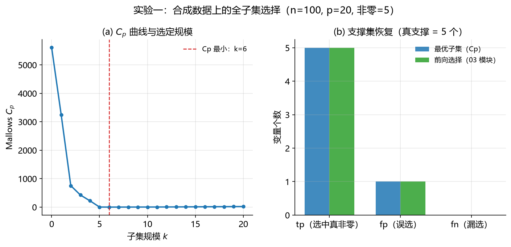
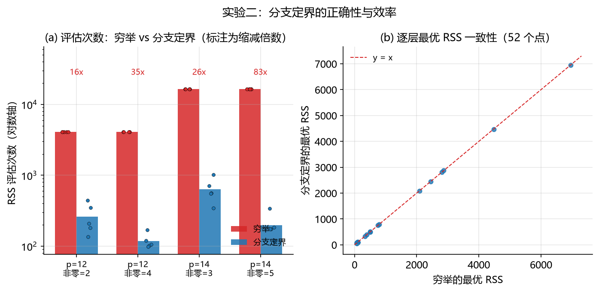
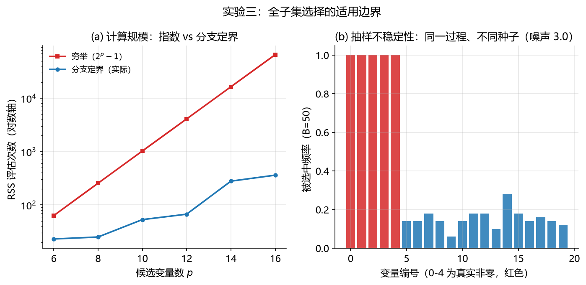

# 04-best-subset-selection 全子集选择与分支定界（Best Subset Selection & Branch and Bound）

全子集选择回答变量选择问题的最强形式：对每个模型规模 $k$，找出**训练 RSS 意义下全局最优**的 $k$ 变量子集——这是组合优化意义的最优，不等于预测最优或科学意义的最优（限定详见 §1.1 与 §5）；分支定界则试图用远少于穷举的计算量找到它（最坏情况仍是指数级）。它对应主 README §2.2（算法化筛选时代第二项），也是本仓库第四个方法学习模块。它直接承接 03-stepwise-selection 模块的结论：逐步法是贪心搜索，可能错过最优子集——本模块给出“精确答案 + 可行计算”的回应，并再次撞上同一堵墙：**即使全局最优，选择结果依然不稳定**。本文档按“背景与动机 → 数学原理 → 算法步骤 → 实现讲解 → 实验设计与结果分析 → 复现方式 → 关联文献”七段展开；配套代码见 [`best_subset.py`](best_subset.py)（从零实现，逐段讲解）与 [`experiment.py`](experiment.py)（三组可复现实验）。

> **阅读前提与符号约定**：本文档可独立阅读——所有符号在此表定义，实验指标在 §5 评估指标说明表中统一定义，文献引用均为本文档 §7 的局部编号（每条后标注主 README §4 总编号）。未按顺序阅读的读者建议先读 §2（数学原理）再回看 §1；§5 的实验只使用本表符号。前置知识：建议先读 01-least-squares（每步的内核是 OLS，$n/p/X/y/\beta$ 等基础符号与之相同）。
>
> | 符号 | 含义 | 定义位置 |
> | :--- | :--- | :--- |
> | $n,\ p$ | 样本数、候选预测变量个数（同 01 模块） | §2.1 |
> | $\beta$ | 真实系数向量（数据生成参数；以 $\lvert\beta_j\rvert>10^{-8}$ 判定非零） | §5.1 |
> | $\hat y = X\hat\beta$ | 预测响应 | §5.1 |
> | $k$ | 目标模型规模（子集变量个数） | §2.1 |
> | $S$ | 候选/选中的变量子集 | §2.1 |
> | $\mathrm{RSS}(S)$ | 子集 $S$ 上 OLS 的残差平方和 | §2.1 |
> | $U$ | 搜索树节点的“最大完成集”：已纳入变量 ∪ 全部未决定变量 | §2.3 |
> | $\mathrm{best}[k]$ | 当前已找到的最优 $k$ 子集 RSS（incumbent） | §2.3 |
> | $\hat\sigma^2$ | 误差方差估计（全模型残差方差） | §2.4 |
> | $C_p$ | Mallows $C_p$ 统计量 | §2.4 |
> | $B$ | 实验三的重拟合次数 | §5.3 |
> | Jaccard | 两集合相似度 $\lvert A\cap B\rvert / \lvert A\cup B\rvert$ | §5 指标表 |
> | RSS 评估次数 | 子集回归的拟合次数（计算成本单位） | §5 指标表 |

## 1. 背景与动机

### 1.1 要解决的问题

给定 $p$ 个候选变量，逐步法用贪心搜索给出一个“够好”的子集；但贪心的每一步局部最优不保证全局最优——早期选错一个变量，后面再难纠正。全子集选择把问题问到底：**对每个规模 $k$，在所有 $\binom{p}{k}$ 个 $k$ 变量子集中，RSS 最小的那个是哪个？** 穷举的答案是 $2^p$ 次回归（§2.2），$p=20$ 时约一百万次、$p=30$ 时约十亿次——直接穷举在 1960 年代的计算机上不可行，在今天也只是勉强。于是问题变成：**能不能不全部查看就找到全局最优？**（本章的“全局最优”均指固定训练数据、固定规模 $k$、训练 RSS 目标下的组合优化最优；它不等于测试误差最小、真实支撑集或因果变量，见 §5 的讨论。）

### 1.2 诞生背景

- **Furnival & Wilson (1974)** 在 *Technometrics* 发表“Regressions by leaps and bounds”，给出 leaps-and-bounds 算法：利用 RSS 的单调性构造搜索树与界，在典型情形下以远少于 $2^p$ 次回归给出每层最优子集——这是分支定界思想进入变量选择的标志性文献 [1]；
- **Beale, Kendall & Mann (1967)** 代表早期变量剔除与子集筛选思想（原文未获取，定位依据题名与 Mantel (1970) 的同时代转述，详见 03 模块 §1.2）——它是历史背景文献，**并非分支定界算法的来源**；本模块算法思想的来源是 Furnival & Wilson (1974) [1]。Hocking (1976) 的综述对线性回归变量选择体系（全子集、逐步方法、模型评价准则）做了系统整理 [3]；
- 动机的现实性来自 **Hughes 效应**（变量增多反而损害泛化）与计算约束：既需要“全局最优”的保证，又付不起穷举的代价。

### 1.3 为什么重要，以及它的阴影

在固定训练数据、固定规模与训练 RSS 目标下，全子集搜索是比较贪心或启发式搜索的**精确基准**：任何启发式方法（逐步法、正则化路径）都可以与它对照，检验自己离该目标有多远。但它有两个铭刻在文献里的边界：其一，**计算上限**——分支定界的最坏情况仍是 $2^p$，$p$ 上百时无论怎么剪枝都无济于事；其二，**不稳定性**——Miller (1984/1990) 系统讨论了子集选择方法族（含最优子集）对数据、变量相关结构与评价准则的敏感性 [5]：选出来的“全局最优”换个样本就可能变。本模块的特色是把这两条边界都用实验量化（§5.2 验证正确性与实际节省，§5.3 测量规模上限与不稳定性），并给出一个出乎意料的分析结论：在 $k \ge$ 真支撑规模的区间内，$C_p$ 定模的不稳定性与信噪比无关（尺度不变，§5.3）。

## 2. 数学原理

### 2.1 问题形式化

对候选变量的子集 $S$（$|S|=k$），拟合带截距的 OLS（截距经中心化实现：对 $X$、$y$ 去均值后拟合无截距模型，再以 $\bar y - \bar x^\top\hat\beta$ 还原截距），定义残差平方和：

$$
\mathrm{RSS}(S) = \min_{b}\ \|y - X_S b\|_2^2 \tag{1}
$$

全子集选择的目标：对每个 $k = 0, 1, \dots, p$，求

$$
\mathrm{best}[k] = \min_{S:\ |S| = k}\ \mathrm{RSS}(S), \qquad S_k^\ast = \arg\min \tag{2}
$$

$k=0$ 即仅截距模型（$\mathrm{RSS} = \mathrm{TSS}$）。固定 $k$ 的 RSS 最小化也常写成 $L_0$ 约束形式 $\min_{\beta:\|\beta\|_0\le k}\|y - X\beta\|_2^2$（$\|\beta\|_0$ 为非零系数个数）；现代最佳子集研究多以混合整数优化直接求解这类问题（[6]），本模块沿用组合搜索路线。穷举的代价是全部非空子集：

$$
\sum_{k=1}^{p}\binom{p}{k} = 2^p - 1 \tag{3}
$$

### 2.2 单调性引理

整个分支定界建立在一条简单性质上：

$$
S \subseteq T \quad\Longrightarrow\quad \mathrm{RSS}(S) \ge \mathrm{RSS}(T) \tag{4}
$$

（加入变量只会降低 RSS：$T$ 的系数可行集包含 $S$ 的。）它给出两种建树方向：**逆树**（从全集删变量，Furnival & Wilson 原文的方向）中，节点的 RSS 是其子孙（更小子集）RSS 的下界；但逆树对小规模目标有结构性缺陷——最优 $k$ 子集的所有超集都满足 $\mathrm{RSS} \le \mathrm{best}[k]$，永不被剪枝，搜索在最需要它的地方失效。

### 2.3 本实现的搜索树：加法树 + 最大完成集界

本模块改用**加法树**（从空集起，逐个决定变量“纳入/排除”）配“最大完成集”界。考察搜索树节点 $(i, S)$：已处理前 $i$ 个变量（按重要性排序），其中纳入集合为 $S$。记

$$
U := S \cup \{\text{全部未决定变量}\}
$$

为该节点的**最大完成集**——子树中任何一个完成集 $T$（$|T| = k$）都满足 $S \subseteq T \subseteq U$，由引理 (4)：

$$
\mathrm{RSS}(T) \ge \mathrm{RSS}(U)
$$

于是得到剪枝规则：

$$
\mathrm{RSS}(U) \ge \mathrm{best}[k] \quad\Longrightarrow\quad \text{剪枝（子树中无更优的 } k \text{ 子集）} \tag{5}
$$

两个设计要点：① **变量按重要性降序、优先纳入**——首个叶子（最重要的 $k$ 个变量）立刻成为紧 incumbent，后续分支才有界可剪；② 剪枝强度随“已排除的重要变量”增加而增强——排除重要变量使 $U$ 变差、$\mathrm{RSS}(U)$ 增大，正是应该剪掉的分支。注意该界对**固定目标规模 $k$** 成立：搜索逐 $k$ 进行，incumbent 与界都只针对当前 $k$，不存在跨规模共享的界。正确性：纳入/排除树中每个 $k$ 子集对应唯一路径，被剪子树由 (4)(5) 证明不含更优解，未剪路径的叶子逐一评估，故最终 $\mathrm{best}[k]$ 为全局最优（实验二在 20 个随机实例上验证了这一点）。

### 2.4 Mallows $C_p$ 与模型定模

每层最优子集表只回答“每个规模下谁最好”；选哪个规模需要拟合优度与复杂度的权衡。**Mallows $C_p$** [4]：

$$
C_p(S) = \frac{\mathrm{RSS}(S)}{\hat\sigma^2} - (n - 2|S|), \qquad \hat\sigma^2 = \frac{\mathrm{RSS}(\text{全模型})}{n - p - 1} \tag{6}
$$

**参数计数约定**：本实现按预测变量数 $k = |S|$ 计数（不含截距）；标准写法常按总参数数 $q = k+1$（$k$ 个预测变量 + 截距）计为 $C_p = \mathrm{RSS}/\hat\sigma^2 - n + 2q$。两者相差常数 2——按规模比较时 $\arg\min$ 不变，但 $C_p$ 的绝对值解释不同（“$C_p \approx$ 参数个数”只在标准计数下成立）。

**解释与适用条件**：在经典线性模型、误差独立同方差、$\hat\sigma^2$ 由全模型合理估计、且候选模型包含真实均值结构时，$E[C_p] \approx q$（总参数数）——$C_p$ 接近参数个数的模型既不过拟合也不欠拟合。最小 $C_p$ 是**预测误差导向的模型选择准则**，不保证恢复真实支撑集：有限样本、候选众多时最小点可能偏大或不稳定（§5.3 有实测）。Furnival & Wilson 的 leaps-and-bounds 正是配合 $C_p$ 使用 [1]。

注意 $C_p$ 要求全模型可估计（$n > p + 1$）；$p$ 接近或超过 $n$ 时 $\hat\sigma^2$ 不存在，需改用固定规模或其他准则。其他定模准则（AIC、BIC、交叉验证/GCV）见主 README §2.3，本模块只实现 $C_p$。

## 3. 算法步骤

1. **中心化**：对 $X$、$y$ 去均值，截距由此实现（数值上比显式添加全 1 列更稳）；
2. **重要性排序**：按与响应的绝对边际相关降序排列变量（Furnival & Wilson 原文建议用全模型 $|t|$ [1]；边际相关不依赖全模型可估计，$p \ge n$ 时仍可排序——该替代只改变搜索顺序与剪枝效率，不改变最优结果）；
3. **逐规模搜索**：对 $k = 1, \dots, k_{\max}$（$k_{\max} = \min(p, n-2)$），从根节点 $(0, \varnothing)$ 做深度优先的纳入/排除搜索——优先纳入当前变量（重要性降序），每个节点计算其最大完成集 $U$ 的 RSS 作为界，$\mathrm{RSS}(U) \ge \mathrm{best}[k]$ 即剪枝；叶节点（$|S| = k$）的 RSS 参与 incumbent 竞争；
4. **汇总**：得到每层最优子集表 $\{S_k^\ast\}_{k=0}^{k_{\max}}$ 与对应的 RSS 表；
5. **定模**：按 (6) 计算各规模 $C_p$，取最小者（并列时取较小规模，偏向简单模型）。

**复杂度**：最坏情况 $O(2^p)$（剪枝全部失效时）；实际评估次数取决于数据——稀疏信号下剪枝旺盛（§5.2 实测缩减 9–140 倍），弱信号下逼近穷举。每次评估是一个子集 OLS（`lstsq`，约 $O(nk^2)$）；跨规模共享缓存，每个子集只拟合一次。

**边界条件**：① 共线或重复列——子集设计阵秩亏，用最小范数解，RSS 仍可计算但方向不唯一；② $n - p - 1 < 1$——全模型不可估，$C_p$ 不可用（`fit` 抛 `ValueError`）；③ $k$ 或 $k_{\max}$ 越界——入口处抛 `ValueError`；④ $p$ 很大时穷举法会给出显式警告（评估次数随 $2^p$ 爆炸）。

## 4. 实现讲解

[`best_subset.py`](best_subset.py) 按五段组织：

| 代码段 | 内容 | 对应本文 |
| :--- | :--- | :--- |
| 第 1 段 `fit_subset_rss` / `_importance_order` | 公共内核：子集 OLS 与重要性排序 | §2.1、§3 步骤 1–2 |
| 第 2 段 `exhaustive_best_subsets` | 穷举全部子集（正确性基准） | §2.1、公式 (3) |
| 第 3 段 `branch_and_bound` | 分支定界：加法树 + 最大完成集界 | §2.3、公式 (4)(5) |
| 第 4 段 `mallows_cp` / `cp_table` | Mallows $C_p$ 与定模 | §2.4、公式 (6) |
| 第 5 段 `BestSubsetSelector` 类 | 统一接口 + 可审计的选择过程 | §3 |

三点设计说明：

- **穷举与剪枝两套实现并存**：穷举是分支定界的正确性基准（实验二逐实例对照），也是小 $p$ 时的合理选择；两者通过 `method` 参数切换，结果结构完全一致；
- **`subsets_` 与 `cp_by_k_` 把过程变成对象**：每层最优子集和整条 $C_p$ 曲线直接可读——定模是否合理（最小点是否尖锐、是否落在真支撑规模）不需要重新跑实验；
- **接口与 03 模块 `StepwiseSelector` 对齐**（`fit/predict/score`），使实验一可以与逐步法同参数对照。

## 5. 实验设计与结果分析

三组实验由 [`experiment.py`](experiment.py) 一键运行，所有随机种子固定；图表在 `figures/`，数值结果在 `results/`。

**三组实验的分工**：分支定界有三个必须分别回答的问题——

| 实验 | 验证的性质 | 手段 |
| :--- | :--- | :--- |
| 一 | 统计性质（选择质量、定模行为与预测收益） | 与 01/03 同参数合成数据，四种方法对照 |
| 二 | 工程性质（剪枝的正确性与实际节省） | 20 个随机实例与穷举逐层对照 |
| 三 | 适用边界（计算规模与选择稳定性） | 评估次数随 $p$ 增长 + $B=50$ 重抽样 + 尺度不变性核查 |

**评估指标说明**（全文通用，先定义后使用）：

| 指标 | 定义 | 计算方式 | 结果解读 |
| :--- | :--- | :--- | :--- |
| tp / fp / fn | 选中集合与真支撑集的交集/差集计数（真支撑集 = 数据生成中系数非零的变量集合，以 $\lvert\beta\rvert>10^{-8}$ 判定） | `lib.metrics.support_recovery` | tp=选中的真非零、fp=误选、fn=漏选 |
| Jaccard | $\mathrm{tp}/(\mathrm{tp}+\mathrm{fp}+\mathrm{fn})$ | 由 tp/fp/fn 导出 | 综合相似度，$[0,1]$，1 为完全恢复 |
| 选中变量数 $k$ | $\lvert S\rvert$ | `len(selected_)` | 模型规模 |
| 训练/测试 MSE | $\frac{1}{n}\sum_i (y_i - \hat y_i)^2$，即预测值与真值的均方误差 | `lib.metrics.mse` | 训练集上=拟合优度、测试集上=泛化表现；越小越好 |
| $R^2$ | $1-\mathrm{SS}_{res}/\mathrm{SS}_{tot}$（残差平方和/总平方和） | `BestSubsetSelector.score` | 响应变异中被模型解释的比例，越接近 1 越好 |
| Mallows $C_p$ | $\mathrm{RSS}(S)/\hat\sigma^2 - (n - 2\lvert S\rvert)$ | §2.4 公式 (6) | 拟合优度与复杂度的权衡；最小 $C_p$ 的 $k$ 即选定规模 |
| RSS 评估次数 | 子集回归的拟合次数（跨规模去重） | 实现内计数器 | 计算成本；穷举 $=2^p-1$，分支定界为实际值 |
| 逐层 RSS 一致差 | $\max_k \lvert\mathrm{RSS}_{\text{B\&B}}(k) - \mathrm{RSS}_{\text{穷举}}(k)\rvert$ | 实验二 | 剪枝正确性；0 表示两法结果完全一致 |
| 选择频率 | 变量在 $B$ 次重拟合中被选中的比例 | 实验三 | 接近 1 为稳定，接近 0.5 为随机漂移 |
| 两两 Jaccard | 两次选择集合的 Jaccard 相似度 $\lvert A\cap B\rvert/\lvert A\cup B\rvert$ | 实验三 | 选择结果的整体一致性；1 为完全相同 |

> **阅读提示**：本模块的指标分三层——选择质量（支撑集指标）回答“选得准不准”，预测表现（MSE、$R^2$）回答“用得好不好”，计算与稳定性（评估次数、频率、Jaccard）回答“算不算得起、可不可信”。三者不可互相替代：全局最优不保证预测最好（仍可能过拟合），预测好也不代表选得对。

### 5.1 实验一：合成稀疏数据上的方法对照（统计性质）

**设置**：与 01-least-squares、03-stepwise-selection 模块实验一**完全相同**的数据（n=100, p=20, 非零 5，rho=0.3, 噪声 1.0，训练 seed=0，测试 seed=1 生成 2000 个样本），保证跨模块可比。判据：最优子集按 $C_p$ 定模；前向选择用 03 模块的偏 $F$ 判据（$p_{\text{in}}=0.05$，实现为实验脚本内的精简版）。

| 指标 | 最优子集（$C_p$） | 前向选择（03 模块判据） |
| :--- | ---: | ---: |
| 选中变量数 | 6 | 6 |
| tp / fp / fn | 5 / 1 / 0 | 5 / 1 / 0 |
| Jaccard | 0.833 | 0.833 |
| 训练 MSE | 0.900 | 0.900 |
| 测试 MSE | 1.122 | 1.122 |
| $R^2$ | 0.985 | 0.985 |
| RSS 评估次数 | 1809 | —（贪心，每步重算） |

两种方法选中**完全相同的集合** $\{0,1,2,3,4,15\}$——前 5 个真实变量全部命中，唯一假阳性是变量 15。对照基线：全模型 OLS 测试 MSE 1.246，真支撑集 OLS（oracle）1.070。



**分析**：① 相比不选择，有真实收益（1.122 vs 全模型 1.246，约降低 10%）；相比理想选择仍有差距（1.122 vs oracle 1.070）——假阳性变量 15 贡献了这部分损失。② **最优子集与前向选择给出完全相同的选择**：在这个强信号设置里，贪心已经找到了全局最优，“全局最优”的保证没有体现差异——它的价值不在“更好”，而在**保证性与可诊断性**（每层最优表 + 完整 $C_p$ 曲线随时可查），以及 §5.2 展示的“用更少计算拿到同样结果”。③ **$C_p$ 定模的行为值得细看**：$C_p$ 从 $k=5$ 的 1.41 降到 $k=6$ 的 −0.38（最小），$k=7$ 为 −0.25、$k=8$ 为 0.47——最小点落在 $k=6$ 而非真支撑规模 5，且 $k=6$ 与 $k=7$ 的 $C_p$ 差仅 0.13，曲线在最小点附近**近乎平坦**：这正是不稳定性的伏笔（§5.3）。④ **范围说明**：本实验是单次可控模拟，展示该设置下的选择行为与基线差距，不构成系统的 Monte Carlo 研究；多重复下的频率行为见实验三。

### 5.2 实验二：分支定界 vs 穷举（工程性质）

**设置**：20 个随机实例，四种配置（$p=12$ 非零 2/4、$p=14$ 非零 3/5，各 5 个重复），n=100, rho=0.3, 噪声 1.0, seed=100–104。对每个实例分别运行穷举与分支定界（同 $k_{\max}$），逐层比较最优 RSS，并统计 RSS 评估次数。

| 配置 | 穷举评估 | 分支定界评估 | 缩减倍数 |
| :--- | ---: | ---: | ---: |
| $p=12$，非零 2 | 4095 | 262 | 18.8x |
| $p=12$，非零 4 | 4095 | 119 | 35.9x |
| $p=14$，非零 3 | 16383 | 638 | 29.1x |
| $p=14$，非零 5 | 16383 | 197 | 93.5x |

20 个实例的逐层最优 RSS **全部一致**（最大绝对差 0.0）；评估缩减倍数最小 9.3x、最大 140.0x、均值 44.3x。



**分析**：① **正确性**：在本实验的 20 个实例与 `_EPS` 数值容差下，两法得到的各规模最优 RSS 完全一致（最大差 0.0）——这支持当前剪枝实现的正确性（算法层面另有 §2.3 的论证）；有限实例测试不替代一般性证明，若存在 RSS 极其接近的并列最优子集，容差内的取舍可能不同。② **效率的观察**：在本实验的四组配置中，信号更强、边际排序更有辨识度时观察到更多剪枝（同 $p$ 下非零 4 的 35.9x 对非零 2 的 18.8x；非零 5 的 93.5x 对非零 3 的 29.1x）——信号集中时“排除重要变量”的分支被迅速剪掉，搜索自动聚焦到含信息变量的区域；该规律依赖排序与信号结构，不是普遍定理。③ **诚实的边界**：最坏情况仍是指数级、可能退化到接近 $2^p$（剪枝全部失效时，Furnival & Wilson 原文亦明确此点 [1]）；弱信号、变量近似可替代时节省会大幅缩水。本实测只到 $p=16$，**不能外推具体可行上限**——它取决于数据结构、排序与 incumbent 质量。$p$ 更大时的路线有二：现代最佳子集优化（混合整数优化 [6]、快速近似算法 [7]）与惩罚/正则化（主 README §2.4）。

### 5.3 实验三：适用边界（规模与稳定性）

**(a) 计算规模**：评估次数随 $p$ 的增长（n=100, 非零 5, rho=0.3, 噪声 1.0, seed=7）：

| $p$ | 穷举（$2^p-1$） | 分支定界 | 缩减倍数 |
| :--- | ---: | ---: | ---: |
| 6 | 63 | 23 | 3x |
| 8 | 255 | 25 | 10x |
| 10 | 1023 | 53 | 19x |
| 12 | 4095 | 67 | 61x |
| 14 | 16383 | 279 | 59x |
| 16 | 65535 | 361 | 182x |

穷举每加 2 个变量翻四倍；分支定界在此范围内增长平缓（23 → 361），但最坏情况下仍为**指数级**、可能退化到接近 $2^p$ 的穷举——$p$ 继续增大时终将爆炸。

**(b) 重抽样不稳定性**：同一生成过程、$B=50$ 个种子（n=100, p=20, 非零 5, rho=0.3, 噪声 3.0, $k_{\max}=12$），考察 $C_p$ 选定的模型：

| 指标 | 数值 |
| :--- | ---: |
| 真支撑变量的选中频率 | 1.00 × 5（全部稳定命中） |
| $C_p$ 选定规模 $k^\ast$ | 均值 7.28；分布 {5: 5, 6: 16, 7: 11, 8: 5, 9: 5, 10: 7, 11: 1} |
| 选择结果两两 Jaccard | 均值 0.604（min 0.312，max 1.0） |
| 与真支撑集的平均 Jaccard | 0.721（std 0.154） |
| 噪声变量被选频率 | 0.06–0.28（无稳定假阳性） |



**分析**：① **全局最优同样不稳定**——与 03-stepwise-selection 模块 §5.3 的结论并列，但机制不同：逐步法的不稳定性来自贪心路径的分叉，最优子集的不稳定性来自 $C_p$ 曲线的**平坦段随机游走**（§5.1 已见伏笔：$k=6$ 与 $k=7$ 的 $C_p$ 只差 0.13）。真支撑稳定命中（频率 1.00），但不稳定的是假阳性的**个数**（$k^\ast$ 在 5–11 间游走）与**身份**（每个噪声变量被选频率仅 0.06–0.28）——两两 Jaccard 0.604 甚至低于逐步法的 0.816。② **尺度不变性核查（本实验最有意思的发现）**：取同一 $X$ 与同一噪声实现、仅把噪声放大 3 倍，$k \ge 5$（真支撑规模）段的 $C_p$ **逐点相同**、选择完全相同——因为该段 RSS 是纯噪声、与 $\hat\sigma^2$ 同步缩放，$C_p$ 作为比值不变。**在该区间内，$C_p$ 定模的不稳定性因此与信噪比无关**：它源于“在一堆噪声变量里挑填补 RSS 最多者”这一选择增益本身就是随机的。这一结论**不能外推到** $k <$ 真支撑规模的区间——该处 RSS 含未解释信号，缩放噪声不再同步，$C_p$ 曲线与最小点都会改变；也不意味着改变信号结构（而不仅是噪声尺度）时选择不变。它与 03 模块共线掩蔽场景（信噪比起作用）形成互补——离散选择方法的脆弱性有两种来源：抽样噪声下的选择漂移（尺度不变）与近替代特征下的身份翻转（信噪比相关）。③ **实践含义**：报告最优子集结果时，单个“全局最优”集合几乎没有信息量；必须同时报告 $C_p$ 曲线形状（最小点是否尖锐）与重抽样下的选择频率。还要强调：**分支定界解决的是组合搜索的精确性，不解决选择后的统计推断**——最优子集上的普通 $p$ 值与置信区间不能按预先指定模型解释（选择后推断见 [8][9] 与主 README §2.6），这正是主 README §2.6 稳定性选择与选择后推断方法的动机；而 $C_p$ 曲线的平坦性也预示了下一步：与其在离散搜索里追求“选对”，不如换连续惩罚的范式（主 README §2.4）或现代最佳子集优化（[6][7]）。

## 6. 复现方式

环境：Python ≥ 3.9，依赖见仓库根目录 `requirements.txt`。

```bash
pip install -r requirements.txt
python methods/04-best-subset-selection/experiment.py
```

输出：`figures/` 下 3 张图（150 dpi PNG，由 `lib/plotting.py` 统一样式自动生成），`results/` 下 6 个结果文件（3 个 JSON 汇总 + 3 个 CSV 明细）。脚本与所在目录无关，可从任意工作目录运行；图表与数值均可由上述命令一键再生。

## 7. 本模块参考文献

本文档自足——正文中所有 [n] 均指本表；每条末尾括号内为主 README §4 的总编号（根文档收录全部 64 条题录及 PDF 获取状态，供延伸查阅）。

1. Furnival, G. M., & Wilson, R. W., Jr. (1974). Regressions by leaps and bounds. *Technometrics*, 16(4): 499–511. DOI: [10.1080/00401706.1974.10489231](https://doi.org/10.1080/00401706.1974.10489231).［[PDF](../../papers/Furnival_Wilson_1974_LeapsBounds.pdf)；leaps-and-bounds 原文，RSS 单调性剪枝思想的来源；本实现为借鉴其思想的教学变体（加法树 + 最大完成集界），非原文逆树的逐行复现，支撑 §1.2/§2.2/§2.3］（主 README §4 编号 8）
2. Beale, E. M. L., Kendall, M. G., & Mann, D. W. (1967). The discarding of variables in multivariate analysis. *Biometrika*, 54(3–4): 357–366. DOI: [10.1093/biomet/54.3-4.357](https://doi.org/10.1093/biomet/54.3-4.357).［题录已核验，PDF 待补；变量剔除与早期子集筛选思想的历史背景文献（定位详见 03 模块 §1.2）；并非分支定界算法的来源，支撑 §1.2］（主 README §4 编号 7）
3. Hocking, R. R. (1976). The analysis and selection of variables in linear regression. *Biometrics*, 32(1): 1–49. DOI: [10.2307/2529336](https://doi.org/10.2307/2529336).［题录已核验，PDF 待补；线性回归变量选择的经典综述，系统讨论全子集、逐步方法与模型评价准则，并涵盖分支定界类搜索，支撑 §1.2］（主 README §4 编号 9）
4. Mallows, C. L. (1973). Some comments on $C_p$. *Technometrics*, 15(4): 661–675. DOI: [10.1080/00401706.1973.10489103](https://doi.org/10.1080/00401706.1973.10489103)（JSTOR: 10.2307/1267380）.［[PDF](../../papers/Mallows_1973_SomeCommentsCp.pdf)；$C_p$ 准则原文，支撑 §2.4/§5.1/§5.3］（主 README §4 编号 10）
5. Miller, A. J. (1984). Selection of subsets of regression variables (with discussion). *Journal of the Royal Statistical Society, Series A*, 147(3): 389–425. DOI: [10.2307/2981576](https://doi.org/10.2307/2981576).［[PDF](../../papers/Miller_1984_SubsetSelection.pdf)；专著版 Miller (1990), *Subset Selection in Regression*；子集选择方法族（含最优子集）的系统性质疑，支撑 §1.3/§5.3］（主 README §4 编号 12）
6. Bertsimas, D., King, A., & Mazumder, R. (2016). Best subset selection via a modern optimization lens. *The Annals of Statistics*, 44(2): 813–852. DOI: [10.1214/15-AOS1388](https://doi.org/10.1214/15-AOS1388).［[PDF](../../papers/Bertsimas_King_Mazumder_2016_BestSubsetSelection.pdf)；现代最佳子集的混合整数优化（MIO）视角，支撑 §2.1 的 $L_0$ 连接与 §5.2/§5.3 的现代路线讨论］（主 README §4 编号 47）
7. Hazimeh, H., & Mazumder, R. (2020). Fast best subset selection: coordinate descent and local combinatorial optimization algorithms. *Operations Research*, 68(5): 1517–1537. DOI: [10.1287/opre.2019.1919](https://doi.org/10.1287/opre.2019.1919).［[PDF](../../papers/Hazimeh_Mazumder_2020_FastBestSubsetSelection.pdf)；快速最佳子集的坐标下降/局部组合优化算法，支撑 §5.2/§5.3 的现代路线讨论］（主 README §4 编号 48）
8. Berk, R., Brown, L., Buja, A., Zhang, K., & Zhao, L. (2013). Valid post-selection inference. *The Annals of Statistics*, 41(2): 802–837. DOI: [10.1214/12-AOS1077](https://doi.org/10.1214/12-AOS1077).［[PDF](../../papers/Berk_etal_2013_ValidPostSelectionInference.pdf)；选择后推断：同时置信区间（post-selection inference），支撑 §5.3 ③ 的推断警示］（主 README §4 编号 42）
9. Lee, J. D., Sun, D. L., Sun, Y., & Taylor, J. E. (2016). Exact post-selection inference, with application to the lasso. *The Annals of Statistics*, 44(3): 907–927. DOI: [10.1214/15-AOS1371](https://doi.org/10.1214/15-AOS1371).［[PDF](../../papers/Lee_Sun_Sun_Taylor_2016_ExactPostSelectionInference.pdf)；条件于选择事件的精确选择后推断，支撑 §5.3 ③ 的推断警示］（主 README §4 编号 44）
10. Hastie, T., Tibshirani, R., & Friedman, J. (2009). *The Elements of Statistical Learning* (2nd ed.). New York: Springer. DOI: [10.1007/978-0-387-84858-7](https://doi.org/10.1007/978-0-387-84858-7).［题录已核验，PDF 待补；子集选择与正则化路径的现代视角（子集选择见第 3 章），本模块指标定义的教材级参考］（主 README §4 编号 60）
