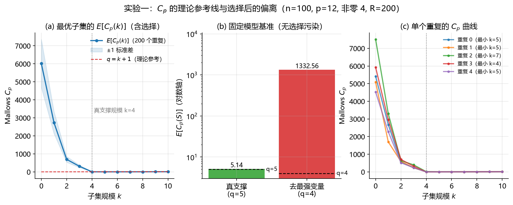
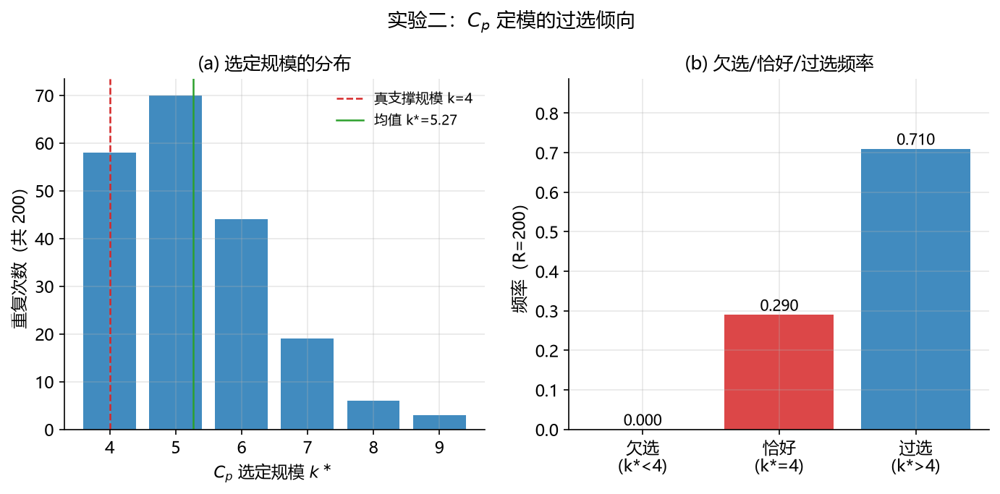
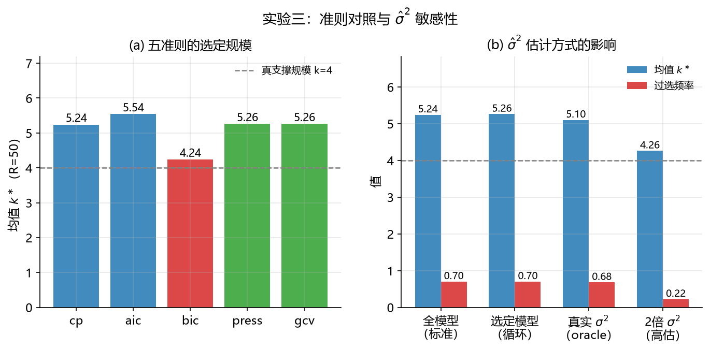

# 05-mallows-cp Mallows Cp 与模型定模准则（Mallows Cp & Model Selection Criteria）

上一个模块（04-best-subset-selection）回答了“每个规模下哪个子集最优”；本模块回答接下来的问题：**选哪个规模**。Mallows $C_p$ 把“选规模”从拍脑袋变成**可估计的量**——在经典线性模型条件下，对**预先指定**的模型，它估计**固定设计点上**新响应的期望预测误差（无偏，差一个常数），再减去复杂度代价，因而成为连接子集搜索与模型定模的桥梁（对应主 README §2.2“Mallows Cp”行）。本模块回收 04 模块埋下的三个伏笔：$C_p$ 曲线为何在最小点附近**近乎平坦**、$C_p$ 定模的 $k^\ast$ 为何在重抽样下游走、以及“其他定模准则”究竟是什么。本文档按“背景与动机 → 数学原理 → 算法步骤 → 实现讲解 → 实验设计与结果分析 → 复现方式 → 关联文献”七段展开；配套代码见 [`mallows_cp.py`](mallows_cp.py)（从零实现，逐段讲解）与 [`experiment.py`](experiment.py)（三组可复现实验）。

> **阅读前提与符号约定**：本文档可独立阅读——所有符号在此表定义，实验指标在 §5 评估指标说明表中统一定义，文献引用均为本文档 §7 的局部编号（每条后标注主 README §4 总编号）。未按顺序阅读的读者建议先读 §2（数学原理）再回看 §1；§5 的实验只使用本表符号。前置知识：建议先读 04-best-subset-selection（“每层最优子集表”由那里产生，本模块只含教学规模穷举）。
>
> | 符号 | 含义 | 定义位置 |
> | :--- | :--- | :--- |
> | $n,\ p$ | 样本数、候选预测变量个数（同 01 模块） | §2.1 |
> | $k$ | 子集规模（预测变量个数，不含截距） | §2.1 |
> | $q$ | 模型参数个数 $= k + 1$（含截距） | §2.2 |
> | $\beta$ | 真实系数向量（数据生成参数；以 $\lvert\beta_j\rvert>10^{-8}$ 判定非零） | §5.1 |
> | $\hat y = X\hat\beta$ | 预测响应 | §5.1 |
> | $\mathrm{RSS}(S)$ | 子集 $S$ 上 OLS 的残差平方和 | §2.1 |
> | $\hat\sigma^2$ | 误差方差估计（默认取全模型残差方差） | §2.2 |
> | $C_p$ | Mallows $C_p$ 统计量 | §2.2 |
> | $h_{ii}$ | hat 矩阵对角线（第 $i$ 个样本的杠杆值） | §2.3 |
> | PRESS / GCV | 留一交叉验证残差平方和及其加权版本 | §2.3 |
> | AIC / BIC | 信息准则（惩罚项分别为 $2q$ 与 $q\ln n$） | §2.4 |
> | $R$ | 实验的重复次数 | §5.1 |
> | $k^\ast$ | 准则选定的模型规模 | §5.2 |

## 1. 背景与动机

### 1.1 要解决的问题

给定 04 模块产出的每层最优子集表 $\{S_k^\ast\}_{k=0}^{k_{\max}}$ 与对应的 RSS 表，最后一个自由参数是规模 $k$ 本身。朴素做法（“看 RSS 下降到满意为止”）一定失败：RSS 随 $k$ 单调下降，永远“再加一个更好”。**必须有一个同时惩罚复杂度的量**，且这个量最好直接估计我们真正关心的东西——预测误差。Mallows $C_p$ 正是这样的量：它估计“在训练点上用估计模型预测新响应”的总失配，减去自由度代价后，恰好可以对不同 $k$ 公正比较。

### 1.2 诞生背景

- **Mallows (1973)** 在 *Technometrics* 给出 $C_p$ 的经典系统阐述：对预先指定的模型，它是固定设计点上预测误差的无偏估计（差一个常数），这是“用估计量代替真实预测误差来做模型选择”的早期系统阐述 [1]；
- 它与 Furnival & Wilson (1974) 的 leaps-and-bounds 天然配对——后者给出每层最优子集表，$C_p$ 负责从表中选规模（见 04 模块 §2.4）；
- 随后形成了**同一思想的不同惩罚**家族：Akaike (1974) 的 AIC [3]、Schwarz (1978) 的 BIC [4]、Golub, Heath & Wahba (1979) 的 GCV [5]，以及 Stone (1974) 的交叉验证路线 [6]；Miller (1984/1990) 的系统研究则记录了这一族准则在有限样本下的选择行为 [7]。ESL 第 3 章给出了统一的现代表述 [2]。

### 1.3 为什么重要，以及它的阴影

$C_p$ 的重要性在于它把模型选择变成**可计算的估计问题**：不需要知道真实模型，只需要数据与一个合理的 $\hat\sigma^2$。它的阴影同样清晰：其一，$C_p$ 估计的是**训练点上的预测误差**，不是泛化误差的全部；其二，对**被选出来的**子集（而非预先指定的子集），选择本身带来乐观偏差——$C_p$ 曲线因此比理论更平坦，最小点随机右移（§5.1 将直接测量这一点）；其三，$\hat\sigma^2$ 是实际的杠杆（§5.3）。

## 2. 数学原理

### 2.1 问题形式化

对候选变量的子集 $S$（$|S|=k$），拟合带截距的 OLS（截距经中心化实现：对 $X$、$y$ 去均值后拟合无截距模型，再以 $\bar y - \bar x^\top\hat\beta$ 还原截距），定义残差平方和：

$$
\mathrm{RSS}(S) = \min_{b}\ \|y - X_S b\|_2^2 \tag{1}
$$

固定 $k$ 的 RSS 最小化等价于 $L_0$ 约束问题 $\min_{\beta:\|\beta\|_0\le k}\|y - X\beta\|_2^2$（现代最佳子集研究多以混合整数优化求解这类问题，见 04 模块 §2.1）。本模块的输入是每层最优子集表；定模任务是对每个 $k$ 计算准则值并取最小。

### 2.2 Mallows $C_p$：预测误差的无偏估计（固定模型 + 经典条件）

先用全模型估计误差方差：

$$
\hat\sigma^2 = \frac{\mathrm{RSS}(\text{全模型})}{n - p - 1} \tag{2}
$$

对**预先指定**的模型 $S$（$q = k+1$ 个参数），Mallows $C_p$ 为：

$$
C_p(S) = \frac{\mathrm{RSS}(S)}{\hat\sigma^2} - n + 2q \tag{3}
$$

无偏性的直觉来自恒等式：用估计模型在训练点上预测新响应，总失配 = 噪声（$n$ 项）+ 拟合值的估计方差（$2q$ 量级）。$\mathrm{RSS}(S)/\hat\sigma^2$ 估计前者（在模型正确时约为 $n - q$），加上 $2q$ 的代价后：

$$
E[C_p(S)] = q + \text{（模型遗漏真实变量时的正偏差项）} \tag{4}
$$

即**模型包含真实结构时 $E[C_p]\approx q$；遗漏时 $C_p$ 远高于 $q$**——这就是“$C_p$ 接近参数个数”判据的来历。实验一（§5.1）直接测量这条曲线，并用固定模型基准臂给出无选择污染的验证。

**边界要说清**：$C_p$ 估计的是**固定设计点上**（当前观测的 $X$）对新响应 $y^{\text{new}}$ 的期望平方预测误差，不是任意新 $x$ 分布下的总体泛化误差、测试集 MSE 或交叉验证误差；理论上最干净的情形是 $\sigma^2$ 已知或用独立估计，代入全模型 $\hat\sigma^2$ 后，有限样本性质还依赖全模型与方差估计的可靠性。$\hat\sigma^2$ 要求全模型满秩、$n>p+1$、误差独立同方差且无严重异常值——**全模型可估计不等于方差估计可靠**：$p/n$ 大、异方差或异常值都会使 $\hat\sigma^2$ 失真，整条 $C_p$ 曲线随之移动（§5.3 有实测）。

**参数计数约定**：本模块按总参数数 $q = k+1$（含截距）计，与 Mallows 原文及多数教材一致；04 模块的实现按预测变量数 $k$ 计（差常数 2），两者按规模比较时 $\arg\min$ 相同，但“$C_p\approx q$”的解释只在 $q=k+1$ 计数下成立。最小 $C_p$ 是**预测误差导向的模型选择准则**，不保证恢复真实支撑集（§5.2 有实测）。

### 2.3 交叉验证族：PRESS 与 GCV

$C_p$ 走“解析修正”路线；PRESS 走“计算”路线。对子集模型，留一交叉验证残差有 hat 矩阵恒等式：

$$
\mathrm{PRESS} = \sum_{i=1}^{n}\left(\frac{e_i}{1 - h_{ii}}\right)^2, \qquad h_{ii} = x_i^\top(X_S^\top X_S)^{-1}x_i \tag{5}
$$

GCV 用有效参数个数代替逐个杠杆值，对高杠杆点更稳健：

$$
\mathrm{GCV} = \frac{\mathrm{RSS}/n}{(1 - q/n)^2} \tag{6}
$$

三者都针对训练点预测风险，但在有限样本、杠杆不均匀或方差估计有偏时并不严格等价：$C_p$ 是解析版，PRESS 是逐点版，GCV 是平均版。实验三第一组将并列比较。

### 2.4 信息准则族：AIC 与 BIC

同一 RSS 表上换不同的惩罚项，就得到 AIC 与 BIC（均差一个不影响定模的常数）：

$$
\mathrm{AIC} = n\ln\frac{\mathrm{RSS}}{n} + 2q, \qquad \mathrm{BIC} = n\ln\frac{\mathrm{RSS}}{n} + q\ln n \tag{7}
$$

$C_p$ 与 AIC 都含与参数数目成正比的 $2q$ 复杂度项，但对 RSS 的处理不同（$C_p$ 经 $\hat\sigma^2$ 标准化后线性进入，AIC 经对数似然）——二者不是同一个准则，有限样本行为也不同（§5.3 有实测对照）；BIC 的惩罚 $q\ln n$ 随样本增长，在大样本下一致选择真实规模（若存在），代价是预测误差略高。五准则的对照是实验三第一组。

### 2.5 选择后的乐观偏差：曲线为何平坦

公式 (4) 的无偏性对**预先指定**的模型成立；但准则曲线用的是**每个规模的最优子集**——RSS 是“从 $\binom{p}{k}$ 个候选里挑出来的最小值”，挑的动作本身带来乐观偏差，且随 $k$ 增大（候选更多）而加剧。用期望的语言说：

$$
E\Big[\min_{S}\, C_p(S)\Big]\ \ne\ \min_{S}\, E[C_p(S)]
$$

经典无偏性针对固定 $S$ 的 $E[C_p(S)]$，而全子集选择实际使用的是 $C_p(\hat S)$（$\hat S = \arg\min_S \mathrm{RSS}(S)$）——后者包含模型选择动作本身的额外乐观偏差。其后果是：实测的 $E[C_p(k)]$ 在 $k \ge$ 真支撑规模后**低于** $q$ 线、斜率小于 1——曲线被“压平”，而最小点附近的噪声（$C_p$ 的标准差在 $k\approx$ 真支撑处最大，§5.1）就把 $\arg\min$ 随机地推向右上方。这就是 $C_p$ 系统性**过选**的机制，也是 04 模块 $k^\ast$ 游走的准则层面解释。选择后的乐观偏差还有更深的后果：被选子集上的普通 $p$ 值与置信区间不能按预先指定模型解释（选择后推断见 [8][9] 与主 README §2.6）。

## 3. 算法步骤

1. **子集枚举**：对 $k = 1, \dots, k_{\max}$ 求每层最优子集与 RSS（教学规模穷举；完整分支定界见 04 模块，接口一致可替换）；
2. **估计 $\hat\sigma^2$**：默认全模型残差方差 (2)；也可用选定模型的（循环，有偏）或用户给定值（实验中的 oracle）；
3. **计算准则曲线**：$C_p$/AIC/BIC 由 RSS 表直接计算 (3)(7)；PRESS/GCV 由数据与子集计算 (5)(6)；
4. **定模**：取准则曲线最小者（并列时取较小规模，偏向简单模型）；
5. **输出**：选定 $k^\ast$、选定子集、整条准则曲线与 $\hat\sigma^2$。

**复杂度**：枚举 $\sum_{k\le k_{\max}}\binom{p}{k}$ 次子集回归；准则计算本身 $O(k_{\max})$（PRESS/GCV 每层多一次 $O(nq^2)$ 的 QR）。

**边界条件**：① $n - p - 1 < 1$——全模型不可估，$\hat\sigma^2$ 不存在（`fit` 抛 `ValueError`）；② $h_{ii} \ge 1$（共线或重复样本）——PRESS 不可计算；③ 秩亏子集用最小范数解，RSS 可算但方向不唯一；④ $p$ 较大时穷举给出显式警告（评估次数随 $2^p$ 增长）。

## 4. 实现讲解

[`mallows_cp.py`](mallows_cp.py) 按五段组织：

| 代码段 | 内容 | 对应本文 |
| :--- | :--- | :--- |
| 第 1 段 `fit_subset_rss` / `sigma2_hat_full` / `exhaustive_best_subsets` | 内核：子集 RSS、$\hat\sigma^2$ 与教学规模穷举 | §2.1–2.2 |
| 第 2 段 `mallows_cp` / `cp_curve` | Mallows $C_p$ 与准则曲线 | §2.2、公式 (3)(4) |
| 第 3 段 `hat_diagonal` / `press_rss` / `gcv_rss` | 交叉验证族 | §2.3、公式 (5)(6) |
| 第 4 段 `aic_value` / `bic_value` | 信息准则族 | §2.4、公式 (7) |
| 第 5 段 `ModelCriteriaSelector` 类 | 统一接口 + 可审计的准则曲线 | §3 |

三点设计说明：

- **准则曲线是一等输出**：`criterion_curve_` 与 `sigma2_hat_` 直接可读——最小点是否平坦、$\hat\sigma^2$ 用了哪个估计，都不需要重跑实验；
- **$\hat\sigma^2$ 是显式参数**（`"full"` / `"selected"` / 正数）：实验三将证明它显著影响定模，把它藏进实现里会掩盖这一依赖；
- **接口与 04 模块 `BestSubsetSelector` 对齐**（`fit/predict/score`、`selected_`/`k_`/`coef_`），使两个模块可串联使用（04 出表、05 定模）。

## 5. 实验设计与结果分析

三组实验由 [`experiment.py`](experiment.py) 一键运行，所有随机种子固定；图表在 `figures/`，数值结果在 `results/`。实验设置与 01/03/04 模块同族（n=100, rho=0.3, 噪声 1.0）；$p=12$、非零 4 是为了让 $R=200$ 重复的穷举在可接受时间内完成。

**三组实验的分工**：$C_p$ 有三个必须分别回答的问题——

| 实验 | 验证的性质 | 手段 |
| :--- | :--- | :--- |
| 一 | 统计性质（理论参考线与选择后的偏离） | 固定模型基准臂 + $R=200$ 重复测量 $E[C_p(k)]$ 曲线 |
| 二 | 定模行为（过选倾向与分布） | $R=200$ 重复记录 $k^\ast$ |
| 三 | 适用边界（五准则对照 + $\hat\sigma^2$ 敏感性） | 同一子集表上应用五准则；$\hat\sigma^2$ 四变体 |

**评估指标说明**（全文通用，先定义后使用）：

| 指标 | 定义 | 计算方式 | 结果解读 |
| :--- | :--- | :--- | :--- |
| $C_p$ | $\mathrm{RSS}/\hat\sigma^2 - n + 2q$ | §2.2 公式 (3) | 对预先指定模型、经典线性条件下，固定设计点新响应预测误差的无偏估计；最小 $C_p$ 的 $k$ 为选定规模 |
| $q$ | 参数个数 $= k + 1$（含截距） | $k+1$ | 模型复杂度的计数单位 |
| $E[C_p(k)]$ | $R$ 个重复的 $C_p$ 均值 | 实验一 | 与 $q=k+1$ 参考线比较：在“包含真支撑”区接近参考线，是固定模型无偏性的体现；高于参考线主要反映遗漏真实信号；低于参考线主要反映选择带来的乐观偏差（另有 $\hat\sigma^2$ 估计与有限样本效应） |
| $k^\ast$ | 准则选定的规模 | `argmin` 准则曲线 | 模型规模 |
| 欠选/恰好/过选频率 | $k^\ast <$ / $=$ / $>$ 真支撑规模的重复比例 | 实验二/三 | 定模行为；过选频率高 = 准则偏乐观 |
| AIC / BIC | $n\ln(\mathrm{RSS}/n) + 2q$ / $+ q\ln n$ | §2.4 公式 (7) | 同族准则；惩罚越大越接近真实规模 |
| PRESS / GCV | $\sum(e_i/(1-h_{ii}))^2$ / $\mathrm{RSS}/(n(1-q/n)^2)$ | §2.3 公式 (5)(6) | 交叉验证族；与 $C_p$ 估计同一目标 |
| $\hat\sigma^2$ | 误差方差估计 | §2.2 公式 (2) | $C_p$ 的实际杠杆；估计方式影响定模 |

> **阅读提示**：本模块的指标分两层——无偏性类（$E[C_p]$ 与 $q$ 线的关系）回答“准则理论上是否成立”，选择行为类（$k^\ast$、欠/恰/过频率）回答“实际定模是否可靠”。前者成立不保证后者：§5.1 将看到理论与实测的系统性偏离来自**选择**而非公式。

### 5.1 实验一：理论参考线与选择后的偏离（统计性质）

**设置**：$R=200$ 个重复（n=100, p=12, 非零 4, rho=0.3, 噪声 1.0, seed=0–199）。两个臂：**(a) 最优子集臂**——每个重复计算 $k=0$–10 的 $C_p$（对每层 RSS 最优子集，$\hat\sigma^2$ 取全模型），报告重复均值与标准差；**(b) 固定模型臂**——对两个**预先指定**的模型计算 $C_p$：真支撑 $S_{\text{true}}$（$q=5$）与真支撑去掉最强变量后的 $S_{\text{miss}}$（$q=4$），报告重复均值——这是公式 (4) 的无选择污染验证。真支撑规模为 4。

**(a) 最优子集臂**：

| $k$ | $E[C_p(k)]$ | 标准差 | $q=k+1$ | 最优 $k$ 子集包含真支撑的比例 |
| :--- | ---: | ---: | ---: | ---: |
| 0 | 6017.20 | 1343.17 | 1 | — |
| 1 | 2736.14 | 618.08 | 2 | 0.000 |
| 2 | 697.28 | 161.36 | 3 | 0.000 |
| 3 | 314.04 | 67.75 | 4 | 0.000 |
| 4 | 5.14 | 4.30 | 5 | 1.000 |
| 5 | 3.79 | 2.86 | 6 | 1.000 |
| 6 | 3.93 | 1.97 | 7 | 1.000 |
| 7 | 4.73 | 1.35 | 8 | 1.000 |
| 8 | 5.98 | 0.88 | 9 | 1.000 |
| 9 | 7.50 | 0.51 | 10 | 1.000 |
| 10 | 9.20 | 0.24 | 11 | 1.000 |

**(b) 固定模型臂**（预先指定，无选择污染）：

| 模型 | $q$ | $E[C_p(S)]$ | 标准差 |
| :--- | ---: | ---: | ---: |
| 真支撑 $S_{\text{true}}$ | 5 | **5.14** | 4.30 |
| 去最强变量 $S_{\text{miss}}$ | 4 | **1332.56** | 293.72 |



**分析**：① **固定模型臂直接验证公式 (4)**：预先指定的真支撑模型 $E[C_p]=5.14\approx q=5$——无偏性精确成立（全程没有任何“挑选”动作）；遗漏最强变量的模型 $E[C_p]=1332.56\gg q=4$——遗漏真实信号使 $C_p$ 大幅高出参考线。这划出了理论的适用边界：**无偏性是关于“指定模型”的陈述**。② **最优子集臂：无偏性在“包含真支撑”区透出**：$k\ge4$ 时最优 $k$ 子集 100% 包含真支撑（RSS 为纯噪声），$E[C_p]$ 贴近 $q$ 线（$k=4$：5.14 vs 5——与固定模型臂数值相同，因为此时选中的正是真支撑本身）；$k<4$ 时远高于 $q$（$k=2$：697.28 vs 3），“$C_p\approx q$ 即模型合适”的判据由此而来。③ **选择乐观偏差使曲线平坦**：$k\ge5$ 后 $E[C_p]$ **低于** $q$ 线（$k=5$：3.79 vs 6；$k=8$：5.98 vs 9），斜率约 0.8/步而非理想的 1/步——因为每层最优子集是从 $\binom{p}{k}$ 个候选里挑出的最小值（§2.5）；偏离还含 $\hat\sigma^2$ 估计与有限样本效应。④ **噪声最大的地方正是决策发生的地方**：$C_p$ 的标准差在 $k=4$ 处最大（4.30），随 $k$ 迅速衰减（$k=10$ 仅 0.24）——最小点附近的抖动与曲线的平坦叠加，使 $\arg\min$ 系统性地向右漂移，这就是实验二过选倾向的机制。⑤ 单个重复的曲线（图 c）显示最小点散布在 $k=4$–7。

### 5.2 实验二：$C_p$ 的定模行为（过选倾向）

**设置**：同实验一的 $R=200$ 个重复，记录 $C_p$ 选定规模 $k^\ast$。

| 指标 | 数值 |
| :--- | ---: |
| $k^\ast$ 均值（std） | 5.27（1.15） |
| $k^\ast$ 分布 | {4: 58, 5: 70, 6: 44, 7: 19, 8: 6, 9: 3} |
| 欠选频率（$k^\ast<4$） | 0.000 |
| 恰好频率（$k^\ast=4$） | 0.290 |
| 过选频率（$k^\ast>4$） | 0.710 |



**分析**：① **在本设置下 $C_p$ 表现为系统性过选**：71% 的重复选大了、29% 恰好、0% 欠选——与实验一“曲线在 $k\ge4$ 区低于 $q$ 线且平坦”的测量完全一致：$\arg\min$ 被压平的曲线和噪声推向右侧。注意这是本设置（n=100, p=12, 非零 4, ρ=0.3、强信号）下的结果，**不能当作一般定理**——弱信号、强共线、$p/n$ 较大或真实模型不在候集中时，$C_p$ 也可能欠选或表现不同。② 这与 04 模块的发现互相印证：在那里家族标准设置（p=20, 非零 5）下 $C_p$ 选 $k=6$（真支撑 5），这里在 p=12 设置下量化了整个分布。③ **实践含义**：把 $C_p$ 最小点当作“真实规模”会系统性高估；更稳健的用法是报告整条曲线与最小点附近的一段平台（$C_p$ 接近最小值的所有 $k$），或换用惩罚更重的准则（实验三的 BIC）。

### 5.3 实验三：五准则对照与 $\hat\sigma^2$ 敏感性（适用边界）

**设置**：$R=50$ 个重复（同数据设置），(a) 同一子集表上应用五种准则；(b) $C_p$ 在四种 $\hat\sigma^2$ 估计下定模。

**(a) 五准则对照**（均值 $k^\ast$，真支撑 = 4）：

| 准则 | 均值 $k^\ast$ | 恰好 | 过选 | 欠选 |
| :--- | ---: | ---: | ---: | ---: |
| $C_p$ | 5.24 | 0.300 | 0.700 | 0.000 |
| AIC | 5.54 | 0.260 | 0.740 | 0.000 |
| BIC | **4.24** | **0.800** | 0.200 | 0.000 |
| PRESS | 5.26 | 0.260 | 0.740 | 0.000 |
| GCV | 5.26 | 0.300 | 0.700 | 0.000 |

**(b) $\hat\sigma^2$ 估计方式**（$C_p$ 定模）：

| $\hat\sigma^2$ | 均值 $k^\ast$ | 恰好 | 过选 |
| :--- | ---: | ---: | ---: |
| 全模型（标准） | 5.24 | 0.300 | 0.700 |
| 选定模型（循环） | 5.26 | 0.300 | 0.700 |
| 真实 $\sigma^2$（oracle） | 5.10 | 0.320 | 0.680 |
| $2\times$ 真实 $\sigma^2$（高估） | **4.26** | **0.780** | 0.220 |



**分析**：① **$C_p$、PRESS、GCV 行为几乎相同**（5.24–5.26）——与三者同源的构造一致（都针对训练点预测风险，差别在解析/逐点/平均路线）；但这是**本设置下的巧合，不能推广为一般等价**——杠杆不均匀或 $\hat\sigma^2$ 有偏时三者可能分离。② **AIC 略比 $C_p$ 过选更多**（5.54 vs 5.24）：二者都含 $2q$ 复杂度项，但对数形式的 RSS 进入方式使早期 $k$ 的区分更弱。③ **BIC 的重惩罚（$q\ln 100\approx 4.6q$ vs $2q$）恰好抵消选择乐观偏差**：恰好率 80% 对 $C_p$ 的 30%——在本设置下 BIC 是五者中最接近真实规模的；但 BIC 的设计目标是一致性而非预测最优，真实支撑恢复与预测性能不是同一目标，这一结论不应推广为 BIC 普遍更优。④ **$\hat\sigma^2$ 是 $C_p$ 的实际杠杆，但方向微妙**：三个现实估计（全模型/循环/oracle）差异很小（5.10–5.26）——本设置信号强、$p/n$ 小，$\hat\sigma^2$ 都估计得不错；而**系统性高估一倍**会把定模拉向欠选（4.26，过选频率从 0.70 降到 0.22）。这给出一个诚实的警告：不要用“调 $\hat\sigma^2$”来抵消过选——那是用一个新的偏差替换旧的偏差；正确的应对是换准则（BIC）或报告平台区间。⑤ **范围说明**：以上结论基于本设置（信号集中、$p/n$ 小）；弱信号、$p$ 接近 $n$ 或变量近似可替代时，五准则的差异与 $\hat\sigma^2$ 的敏感性都会放大。

## 6. 复现方式

环境：Python ≥ 3.9，依赖见仓库根目录 `requirements.txt`。

```bash
pip install -r requirements.txt
python methods/05-mallows-cp/experiment.py
```

输出：`figures/` 下 3 张图（150 dpi PNG，由 `lib/plotting.py` 统一样式自动生成），`results/` 下 6 个结果文件（3 个 JSON 汇总 + 3 个 CSV 明细）。脚本与所在目录无关，可从任意工作目录运行；图表与数值均可由上述命令一键再生。

## 7. 本模块参考文献

本文档自足——正文中所有 [n] 均指本表；每条末尾括号内为主 README §4 的总编号（根文档收录全部 64 条题录及 PDF 获取状态，供延伸查阅）。

1. Mallows, C. L. (1973). Some comments on $C_p$. *Technometrics*, 15(4): 661–675. DOI: [10.1080/00401706.1973.10489103](https://doi.org/10.1080/00401706.1973.10489103).［[PDF](../../papers/Mallows_1973_SomeCommentsCp.pdf)；$C_p$ 准则原文，支撑 §1.2/§2.2］（主 README §4 编号 10）
2. Hastie, T., Tibshirani, R., & Friedman, J. (2009). *The Elements of Statistical Learning* (2nd ed.). New York: Springer. DOI: [10.1007/978-0-387-84858-7](https://doi.org/10.1007/978-0-387-84858-7).［题录已核验，PDF 待补；子集选择与信息准则的现代表述（第 3 章），本模块指标定义的教材级参考］（主 README §4 编号 60）
3. Akaike, H. (1974). A new look at the statistical model identification. *IEEE Transactions on Automatic Control*, 19(6): 716–723. DOI: [10.1109/TAC.1974.1100705](https://doi.org/10.1109/TAC.1974.1100705).［[PDF](../../papers/Akaike_1974_NewLookModelIdentification.pdf)；AIC 原文，支撑 §2.4/§5.3 的准则对照］（主 README §4 编号 15）
4. Schwarz, G. (1978). Estimating the dimension of a model. *Annals of Statistics*, 6(2): 461–464. DOI: [10.1214/aos/1176344136](https://doi.org/10.1214/aos/1176344136).［[PDF](../../papers/Schwarz_1978_EstimatingDimension.pdf)；BIC 原文，支撑 §2.4/§5.3 的准则对照］（主 README §4 编号 16）
5. Golub, G. H., Heath, M., & Wahba, G. (1979). Generalized cross-validation as a method for choosing a good ridge parameter. *Technometrics*, 21(2): 215–223. DOI: [10.1080/00401706.1979.10489751](https://doi.org/10.1080/00401706.1979.10489751).［[PDF](../../papers/Golub_Heath_Wahba_1979_GeneralizedCrossValidation.pdf)；GCV 原文，支撑 §2.3/§5.3］（主 README §4 编号 14）
6. Stone, M. (1974). Cross-validatory choice and assessment of statistical predictions. *Journal of the Royal Statistical Society, Series B*, 36(2): 111–133. DOI: [10.1111/j.2517-6161.1974.tb00994.x](https://doi.org/10.1111/j.2517-6161.1974.tb00994.x).［题录已核验，PDF 待补；交叉验证选择与评估的经典文献，PRESS 路线的来源，支撑 §1.2/§2.3］（主 README §4 编号 13）
7. Miller, A. J. (1984). Selection of subsets of regression variables (with discussion). *Journal of the Royal Statistical Society, Series A*, 147(3): 389–425. DOI: [10.2307/2981576](https://doi.org/10.2307/2981576).［[PDF](../../papers/Miller_1984_SubsetSelection.pdf)；专著版 Miller (1990), *Subset Selection in Regression*；子集选择与定模准则的系统研究，支撑 §1.2/§5.2］（主 README §4 编号 12）
8. Berk, R., Brown, L., Buja, A., Zhang, K., & Zhao, L. (2013). Valid post-selection inference. *The Annals of Statistics*, 41(2): 802–837. DOI: [10.1214/12-AOS1077](https://doi.org/10.1214/12-AOS1077).［[PDF](../../papers/Berk_etal_2013_ValidPostSelectionInference.pdf)；选择后推断：同时置信区间——被选子集上的普通推断失效的正规处理，支撑 §2.5 的选择后偏差讨论］（主 README §4 编号 42）
9. Lee, J. D., Sun, D. L., Sun, Y., & Taylor, J. E. (2016). Exact post-selection inference, with application to the lasso. *The Annals of Statistics*, 44(3): 907–927. DOI: [10.1214/15-AOS1371](https://doi.org/10.1214/15-AOS1371).［[PDF](../../papers/Lee_Sun_Sun_Taylor_2016_ExactPostSelectionInference.pdf)；条件于选择事件的精确选择后推断，支撑 §2.5 的选择后偏差讨论］（主 README §4 编号 44）
